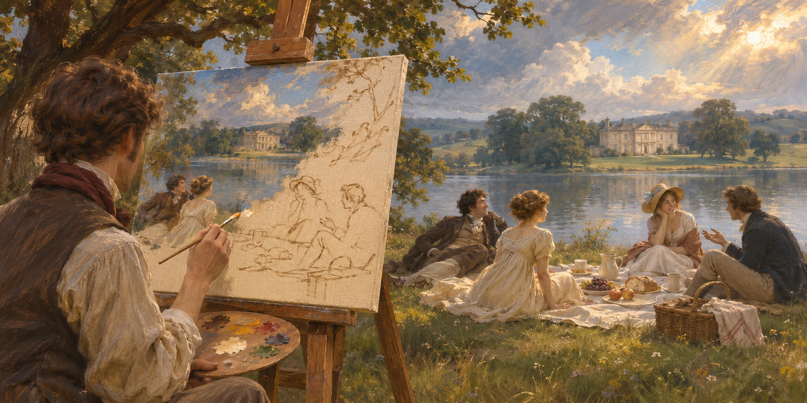

# The Romantic Table illustration style guide



Version 1.1 — ingredient preparation scenes, 13 November 2026.

Create recipe mastheads as oil paintings inspired by British Romantic landscape painting of the late 18th to mid 19th century. Place recognisable, appetising food at the centre of a believable setting that expresses its occasion, place or social character. For dishes eaten on their own, show the finished dish. For ingredient or component recipes, show the ingredient being made, never presented for eating on its own.

The approved direction is a **2:1 horizontal image, without lettering, in a timeless setting**, with **clear food and more expressive surroundings**. The seven paintings in this package are reference examples for future illustrations, with the ingredient-recipe restriction noted under **Reference examples**. The original SVG README banner (`images/Readme_banner.svg`) is outside this style system and must not be used as a reference.

## The visual idea

Imagine sitting down to eat, or watching a cook make an ingredient, while weather, landscape and company surround the table or work surface. The food rests on a real surface close to the viewer. For ingredient recipes, the preparation action and its result must be clearly visible together. A receding landscape, open window, veranda or terrace establishes depth; light connects the food to that environment.

Use a substantial sky or atmospheric distance, contrasts between illuminated passages and deep colour, and visible brushwork. Aim for warmth, appetite, intimacy and quiet drama. This is an original collection, not a reproduction of a particular painting.

## Painting references

These sources inform the art direction; their application to food is our design choice.

- **Turner:** warm sunset colours moving into hazy blue distance, with selective raised paint in clouds. Transfer those colour and surface relationships to the surroundings and small illuminated accents on food. See the National Gallery's [The Fighting Temeraire](https://www.nationalgallery.org.uk/paintings/joseph-mallord-william-turner-the-fighting-temeraire).
- **Constable:** closely observed changing light, varied visible brushwork and coloured grounds that contribute to atmosphere. Transfer these qualities to believable weather, foliage and underlying warmth. See the V&A's [Constable's oil sketches](https://www.vam.ac.uk/articles/constables-oil-sketches).
- **Wright of Derby:** use candlelight unifying figures around a table as a secondary lighting reference for nocturnal scenes. His [An Experiment on a Bird in the Air Pump](https://www.nationalgallery.org.uk/paintings/joseph-wright-of-derby-an-experiment-on-a-bird-in-the-air-pump/) dates from 1768, outside the primary period brief; borrow the lighting relationship, not its subject or composition.

## What stays consistent

| Element | Collection rule |
| --- | --- |
| Format | One uninterrupted 2:1 landscape painting, with no inset, border or frame. |
| Main subject | The finished dish for recipes eaten on their own; the ingredient being made for ingredient or component recipes. Never present an ingredient as a dish to eat on its own. |
| Hierarchy | Food first, including the essential preparation action for ingredient recipes; setting second; faces, bystanders and incidental props third. |
| Scale | Normal-sized food and vessels seen close to the viewer, grounded on a table, ledge or work surface. No giant food in a miniature landscape. |
| Medium | Oil paint with layered colour, visible directional brushwork and restrained surface texture. |
| Setting | Timeless and inhabited, with natural materials and objects appropriate to the chosen place. |
| Light | One coherent dominant light direction, with believable secondary illumination where needed. |
| Detail | The sharpest, most descriptive marks belong to the food and, for ingredient recipes, the hands and equipment making it. Background detail softens with distance. |
| Text | No recipe title, lettering, labels, signature, watermark or logo inside the artwork. |
| Fidelity | Match the repository recipe's ingredients, preparation and serving instructions, except for an explicit owner-directed presentation choice recorded below. |

## What may change

Change location, season, weather, time, vessel, materials, colours and company to suit the dish. Allow daylight, dusk and night. Avoid repeating the same table, window, landscape or foreground prop arrangement. Collection consistency comes from paint handling and visual hierarchy, not identical accessories.

Choose a setting in this order:

1. An explicit setting requested by the owner, such as Halloween for Pumpkin Pie.
2. A social occasion central to the dish, such as friends eating Midnight Spaghetti late at night.
3. A place supported by the recipe, such as Thailand for the curry and paste.
4. A plausible eating environment for a finished dish, or a working kitchen for an ingredient recipe, when the recipe does not supply a distinctive occasion or location.

The setting is an editorial interpretation, not a claim about the dish's origin or the historical age of its technique.

## Composition and scale

Use a viewpoint slightly above the food, approximately 20–35 degrees down towards the table, while retaining a view into the setting. Avoid an overhead flat lay and avoid a viewpoint so low that the bowl hides its contents. For ingredient recipes, adjust the viewpoint to make the preparation action, working hands, equipment and resulting food legible in one continuous scene.

The following are starting targets, not a rigid grid. For ingredient recipes, apply the food and vessel targets to the active preparation area; allow enough room for the cook's hands and essential equipment rather than forcing them into a serving-bowl composition.

| Feature | Target |
| --- | --- |
| Dish centre | Around 45–55% of image width and 62–72% of image height. |
| Main vessel width | Around 45–65% of image width. The initial review set uses strong foreground vessels, often around 50–65%. |
| Dish and vessel height | Around 45–60% of image height, depending on vessel and viewpoint. |
| Table and immediate foreground | Roughly the lower 40–55% of the image. |
| Setting and atmospheric distance | Roughly the upper 45–60%, also visible beside the dish. |
| Essential subject margin | Keep the complete main vessel, all identifying food and any essential preparation action within the inner 90% of the image. |
| Supporting figures | Usually none to four; materially smaller and quieter than the food. A working cook in an ingredient scene is part of the main action; keep their face secondary. |
| Supporting props | Usually two to five readable accents, arranged in small groups rather than scattered everywhere. |

Keep the food, and the preparation action for ingredient recipes, central without forcing symmetry. Table edges, useful utensils, a river or trees can guide the eye towards it. Separate food from background through local contrast. A sun, face or lantern must not compete with it. Large foreground vessels should still feel normal in size, seen close to the viewer.

Include contact shadows; keep table edges, vessel ellipses, reflections and scale consistent. The food and landscape must inhabit one painted space.

## Paint handling

Use earthy underpainting, translucent darks, broad scumbled passages in sky and distance, and opaque touches where light catches food, ceramics and fabric. Keep strokes visible. Suggest minor details with economical marks.

Give food crisp painted accents: pastry crimps, a browned steak crust, curved prawns, pine nuts or glossy sauce. Avoid photographic food against a background that looks filtered.

Let some dark contours merge into shadows, then recover them in light. Reserve the hardest edges and strongest local contrast for the food and any essential preparation action. Suggest people through gesture and colour, without portrait-level detail.

A subtle canvas texture is acceptable. Avoid heavy cracks, yellowed varnish, fake damage, dirty food colours, decorative impasto everywhere, smooth digital airbrushing, cartoon outlines and obvious photographic depth-of-field blur.

## Colour and light

Build each image from a restrained family of warm earth colours, cooler blue-grey distance and a few natural accents. The following colours describe relationships rather than exact pixel targets:

| Colour family | Role |
| --- | --- |
| Warm ivory and pale ochre | Crockery, cream, linen and reflected light. |
| Yellow ochre and muted gold | Lamplight, pastry, curry and warm sky. |
| Burnt sienna, rust and umber | Wood, crusts, autumn vegetation and warm shadows. |
| Muted olive and deep green | Herbs, planting and landscape masses. |
| Slate blue, indigo and blue-grey | Evening, clouds, water and atmospheric distance. |
| Restrained red or coral | Chilli, wine, prawns or another recipe-specific accent. |

Preserve natural food colours: pale rice and cream, fresh herbs, browned steak and coral prawns distinct from their sauces. Show pink meat only when a cut surface is requested. An old-painting effect must not turn everything brown.

Use light to reveal texture and volume: an opening in clouds, low sun, window, candle or lamp, with cool sky light where appropriate. Flames must remain secondary. Keep the food and any essential preparation action legible in shadow at thumbnail size.

## Food, preparation and serving accuracy

Read the recipe in full. Identify whether it makes a dish to eat or an ingredient to use in another recipe. Extract finished form, visible ingredients, texture, doneness, garnish and serving method. For ingredient recipes, also extract the preparation steps, equipment and appearance at the chosen step. Read linked components when they affect appearance.

For dishes eaten on their own, describe the served dish. Include only supported garnishes and accompaniments. Equipment or ingredients should not confuse the finished result; background props may establish the occasion without becoming part of the recipe.

For ingredient or component recipes, show the ingredient being made through a recognisable action from the recipe, with the food and its changing texture clearly visible. Use the actual method and equipment: a cook straining tamarind pulp, for example, or blending curry paste. A standalone bowl or jar of finished paste with ingredients arranged around it is not sufficient. Never present the ingredient for eating on its own, and do not replace it with the dish that later uses it.

Use subtle steam only when the depicted food or preparation step is hot. Pumpkin pie and uncooked curry paste should not steam; tamarind being strained after cooling enough to touch should not have conspicuous steam.

## Props

Choose props for what the cook or diner actually does. In ingredient scenes, preparation equipment must be in use and match the recipe; eating cutlery, place settings and serving garnishes must not imply that the ingredient is eaten on its own. Repeated accessories, folds, corner placement, utensils or flowers should be deliberate rather than automatic. Leaving part of the table bare is acceptable.

## People and place

Keep people behind or beside the food, with relaxed gestures and plausible anatomy. In ingredient scenes, show the cook's working hands and their contact with the food or equipment clearly enough to explain the action. Faces remain secondary.

Use simple clothing, timber, plain ceramics, linen, glass, stone and unobtrusive metal utensils. Avoid conspicuous screens, cables, plastic packaging and branding. Omit machinery from serving scenes rather than inventing an obsolete cooking method. For ingredient scenes, include machinery when the recipe's method needs it, keep its design plain and unbranded, and place it believably on the work surface. A timeless atmosphere must not change the method: Thai Yellow Curry Paste uses a high-speed blender, or a stick blender in a tall jug, never a mortar and pestle.

Establish place through vegetation, materials, water, weather and everyday buildings. Avoid tourist motifs, caricatures and national flags used as shorthand. Verify distinctive structures or cultural details before using them.

## Current recipe briefs

These briefs establish the intended food or preparation action and setting. Use the images in the reference examples section within their stated limits. The existing Thai Yellow Curry Paste painting is a historical style reference, not an approved composition for ingredient recipes; its updated brief below is for future work. The Tamarind Paste painting is the approved reference for an ingredient being made.

| Recipe | Essential food details | Setting and atmosphere | Common errors to prevent |
| --- | --- | --- | --- |
| Chilli con Carne | Thick reddish-brown beef mince chilli with red kidney beans, mushrooms and small carrot pieces; served over basmati rice with a spoonful of soured cream. Coriander leaves and stalks are mixed through the chilli. | A timber porch overlooking open Texas countryside at dusk; substantial sky, warm food and cool distance. | Cubed steak, bean-free chilli, watery soup, nachos, cheese or an invented topping. |
| Midnight Spaghetti | Long spaghetti coated in a pale olive-oil and pasta-water crema; garlic, pine nuts, chilli flecks and herbs; generous finely grated Parmesan with parsley leaves. | An Italian terrace or open room at night; a small group of adult friends drinking wine, talking and playing cards; warm lamplight against cool night air. | Tomato sauce, meatballs, cream sauce, a token dusting of cheese, giant cheese shavings, people dominating the dish. |
| Pumpkin Pie | Smooth orange-brown pumpkin custard in an open-topped, crimped shortcrust pastry case; a clean cut slice reveals the filling; soft whipped cream alongside. A metal or glass pie dish if it remains visible. | An autumn porch or window setting at Halloween, with a carved pumpkin lantern and leaf colour as secondary cues; gentle mystery and welcome. | Pastry lid or lattice, pumpkin chunks in the filling, ceramic pie dish, aggressive horror imagery, lantern brighter than the pie, steam. |
| Reverse Seared Ribeye with Pan Sauce | Sliced ribeye with a brown crust and pink centre, dark pan sauce and coriander leaves. | Rural dining room with a view at dusk. | Bones, grill stripes, or an unrelated sauce. |
| Thai Yellow Curry Paste | A cook making thick, cohesive, smooth mustard-ochre paste with a high-speed blender, or a stick blender in a tall jug. Show the paste visibly being blended, with a few relevant ingredients such as lemongrass, fresh turmeric and shallots subordinate to the action. | An open garden kitchen in Thailand in soft morning light; tropical foliage and everyday timber details. | A standalone bowl of paste presented for eating, a bowl of liquid curry, rice, prawns, red or green curry paste, gritty fibrous texture, mortar and pestle implying the recipe's method, steam. |
| Tamarind Paste | A cook rubbing softened tamarind pulp by hand through a fine-mesh sieve into a pot that is neither aluminium nor copper. Smooth brown, pourable paste collects below; the fibres remain above in the sieve. | A working Thai kitchen with everyday timber details, tropical foliage and atmospheric distance. | A standalone bowl or jar of paste presented for eating, whole pods in place of the pulp block, fibres in the strained paste, a stiff mound of paste, watery translucent sauce, invented garnish, mortar and pestle, conspicuous steam from the cooled pulp. |
| Thai Yellow Prawn Curry | Peeled, headless king prawns in loose C shapes; potato chunks and onion in a rich golden coconut curry, spooned over jasmine rice; coconut-cream spiral, crispy fried shallots, optional coriander leaves and thin red chilli. | A Thai riverside veranda in warm late light, with humid blue-green distance and a quiet water surface. | Shells or heads on served prawns, tightly curled rings, noodles, red or green sauce, missing potatoes, a separate rice bowl replacing the prescribed serving. |

## Prompt template

Use the same style block in every prompt. Change the recipe, subject mode, action, scene and prop fields. Choose a preparation scene for every ingredient or component recipe. Explicitly state the exceptions that matter for that dish rather than relying on a long list of generic exclusions. Do not put a generic linen napkin or tea towel in the shared style block.

```text
Use case: illustration-story.
Asset: one recipe masthead, horizontal 2:1, full-bleed, no text.
Collection: The Romantic Table.

Create an original oil painting inspired by British Romantic landscape
painting of the late 18th to mid 19th century. A clearly rendered,
appetising food subject is central in the foreground within a believable,
atmospheric setting. Use luminous light, restrained earth colours,
cooler receding distance, visible brushwork, translucent shadows,
scumbled atmosphere and selective opaque highlights. Keep the food
painted in the same medium as its surroundings. The setting is timeless,
not a reconstruction of a specific historical year.

Recipe: [EXACT RECIPE TITLE].
Subject mode: [FINISHED DISH FOR EATING, OR INGREDIENT BEING MADE;
INGREDIENT AND COMPONENT RECIPES MUST USE THE SECOND MODE].
Food: [FORM AT THE DEPICTED STAGE, INGREDIENTS THAT MUST BE VISIBLE,
COLOUR, TEXTURE AND DONENESS; GARNISH AND SERVING METHOD ONLY FOR
DISHES EATEN ON THEIR OWN].
Preparation action: [FOR INGREDIENT RECIPES, ONE RECOGNISABLE RECIPE
STEP, THE COOK'S ACTION, ACTUAL EQUIPMENT AND VISIBLE RESULT;
OTHERWISE NOT APPLICABLE].
Vessel and support: [PLAIN SUITABLE VESSEL AND, WHERE NEEDED,
PREPARATION EQUIPMENT ON A REAL TABLE, LEDGE OR WORK SURFACE].
Scene: [PLACE, OCCASION, SEASON, TIME OF DAY, TWO OR THREE CONTEXT CUES].
People: [WORKING COOK FOR AN INGREDIENT SCENE, WITH CLEAR HAND ACTION
AND SECONDARY FACE; OTHERWISE NONE OR A SMALL SUPPORTING GROUP].
Lighting: [DOMINANT SOURCE AND DIRECTION; SECONDARY LIGHT IF NEEDED].
Useful props: [PREPARATION TOOLS FOR INGREDIENT SCENES; EATING OR
SERVING UTENSILS FOR FINISHED DISHES; OMIT REDUNDANT ITEMS].
Cloth: [NONE BY DEFAULT; IF NEEDED, FUNCTION, CONTEXT-APPROPRIATE
MATERIAL, PATTERN, SIZE AND POSITION].
Owner-directed presentation exception: [NONE OR EXACT RECORDED CHOICE].

Composition: normal-scale food close to the viewer, broadly centred in
the lower half, its main vessel or active preparation area around
45–65% of image width. Slightly elevated view shows the food and the
setting beyond it. Keep the complete main vessel and essential action
inside the frame. For ingredient recipes, show working hands, equipment
and resulting food together; never stage the ingredient for eating on
its own. Lead the eye to the food through light, edges and the arrangement
of the table. Background marks soften with distance. Food and its
essential preparation action first, setting second, faces, bystanders
and incidental props third.

Preserve: [RECIPE-SPECIFIC NON-NEGOTIABLE DETAILS].
Avoid: lettering, logos, signatures, watermarks, frames, split panels,
photographic food, fake antique damage, neon colours, cartoon outlines,
floating vessels, giant food, impossible anatomy, clutter or a competing
background focal point, automatic foreground towels or repeated prop
layouts from other images. For ingredient recipes, also avoid standalone
serving presentations, eating place settings and invented preparation
methods. Also avoid [DISH-SPECIFIC ERRORS].

Reference images, if supplied: use only the approved images named here
for brushwork, level of finish, colour relationships and focal hierarchy.
Do not copy their food, props or geography into this new recipe.
The existing Thai Yellow Curry Paste painting is a historical style
reference only, not an approved composition for ingredient recipes.
```

Artist names alone are insufficient instructions. Keep the descriptive style block even when a generation tool accepts image references. If a tool cannot set a ratio directly, request 2:1 in the prompt and check the returned dimensions before delivery.

## File and display standards

The seven reference WebP images are 1,774 × 887 pixels (2:1). **Always name each image exactly like its recipe file, replacing only the .md extension with .webp**, preserving capitalisation and underscores. For example, Midnight_spaghetti.md corresponds to Midnight_spaghetti.webp.

Keep masters at their original resolution. For future generation, aim for at least 2,400 × 1,200 pixels when supported. Never stretch to achieve 2:1. Inspect any crop to retain the full main vessel, essential preparation action and context; regenerate or extend the canvas if necessary.

For a smaller display derivative, preserve the recipe filename stem and use the appropriate extension. The current recipe template requests images about 1,800 pixels wide and no more than 400 KB. Preserve food detail and smooth skies, retain the PNG master, and name the derivative after the recipe, for example `images/Midnight_spaghetti.webp`. Version new candidates instead of overwriting approved files.

Alt text identifies food and setting, for example: “Oil painting of garlic spaghetti with Parmesan on a candlelit table, with friends playing cards behind it.” For ingredient scenes, also identify the action, for example: “Oil painting of a cook straining tamarind pulp through a sieve into a pot in a Thai kitchen.”

## Repeatable generation workflow

1. Read the current recipe. Record its source URL and revision or hash. Identify whether it is a dish eaten on its own or an ingredient or component recipe.
2. Make a food checklist, record owner-directed presentation exceptions and choose a scene using the priorities above. For ingredient recipes, select a recognisable preparation step and record its action, equipment and visible food texture; never use a standalone serving presentation.
3. Consult this guide and its reference images.
4. Choose useful props and explicitly decide whether a cloth is needed. Fill the prompt. Save the exact submitted text, tool or reported model, date, input references and returned image identifier.
5. Generate one image. Inspect at full size and approximately 600 pixels wide.
6. Check food, preparation action where applicable, composition, paint, scene and format. For ingredient recipes, confirm that the image clearly shows the ingredient being made with the recipe's actual method and equipment. Revise failures with targeted changes, preserving earlier candidates.
7. Compare hierarchy, brushwork and light relationships across the collection, without forcing identical colours. Check the set for accidental repetition of accessories, patterns, folds and placement.
8. Present the candidate for owner review. Approval applies to the identified file and revision.
9. After approval, register the reference and any accepted exceptions, prepare the repository derivative and update links.

Store outputs as well as prompts: results can vary between models. Record only settings actually reported or supplied; never invent a seed, model version or quality setting.

## Quality checklist

- [ ] The food is the first thing noticed at recipe-page size.
- [ ] The food matches the current recipe's visible ingredients and the depicted preparation or serving stage, with any owner-directed presentation exception recorded and followed.
- [ ] An ingredient or component recipe shows the ingredient being made through a recognisable recipe action, never presented for eating on its own.
- [ ] Any preparation equipment and working gestures match the recipe's actual method, and the result is visible.
- [ ] The setting communicates the intended occasion or place without explanation.
- [ ] Vessel, food and environment share consistent scale, perspective, light and paint handling.
- [ ] The image feels like an oil painting, with controlled detail and atmospheric depth.
- [ ] Natural food colours remain appetising and distinct.
- [ ] People, hands, utensils and crockery are plausible wherever visible.
- [ ] Props and light sources support the food and any essential preparation action rather than competing with them.
- [ ] Each utensil has an appropriate preparation, serving or eating function for the scene; Pumpkin Pie has a pie server. Ingredient scenes have no eating place setting.
- [ ] There is no unwanted text, signature, logo, frame or artificial damage.
- [ ] The image is exactly 2:1 and the main vessel and any essential preparation action survive the final crop.
- [ ] The master, prompt and source recipe revision are identifiable, plus any export derivative.
- [ ] The image filename matches the recipe filename stem exactly.

## Reference examples

Use these paintings as examples of the collection's paint handling, light and atmosphere, and of composition where the subject mode matches. Adapt the subject and setting to each new recipe without copying their props mechanically. The existing Thai Yellow Curry Paste painting is a historical style reference only: its standalone bowl does not meet the ingredient-preparation rule and is not an approved composition for ingredient recipes.

- [Chilli con Carne](images/Chilli_con_carne.webp) — warm dusk, a grounded lantern and an inviting bowl.
- [Midnight Spaghetti](images/Midnight_spaghetti.webp) — candlelit social scene and cool night sky.
- [Pumpkin Pie](images/Pumpkin_pie.webp) — autumn light, Halloween setting and pie server.
- [Reverse Seared Ribeye with Pan Sauce](images/Reverse_seared_ribeye_with_pan_sauce.webp) — the original sliced-steak painting, interior light and landscape.
- [Tamarind Paste](images/Tamarind_paste.webp) — a cook straining tamarind pulp into a pot in a Thai kitchen; an ingredient being made.
- [Thai Yellow Curry Paste](images/Thai_yellow_curry_paste.webp) — historical style reference for paint, light and a garden kitchen; not an approved ingredient-recipe composition.
- [Thai Yellow Prawn Curry](images/Thai_yellow_prawn_curry.webp) — golden curry and a Thai riverside setting.

The original six reference examples were created from earlier food briefs following these repository recipes; Tamarind Paste follows the ingredient-preparation rule. Apply the current briefs and ingredient-preparation rule to new illustrations.

- [Chilli con Carne](https://github.com/John-44/Recipes/blob/main/recipes/Chilli_con_carne.md)
- [Midnight Spaghetti](https://github.com/John-44/Recipes/blob/main/recipes/Midnight_spaghetti.md)
- [Pumpkin Pie](https://github.com/John-44/Recipes/blob/main/recipes/Pumpkin_pie.md)
- [Reverse Seared Ribeye with Pan Sauce](https://github.com/John-44/Recipes/blob/main/recipes/Reverse_seared_ribeye_with_pan_sauce.md)
- [Tamarind Paste](https://github.com/John-44/Recipes/blob/main/recipes/Tamarind_paste.md)
- [Thai Yellow Curry Paste](https://github.com/John-44/Recipes/blob/main/recipes/Thai_yellow_curry_paste.md)
- [Thai Yellow Prawn Curry](https://github.com/John-44/Recipes/blob/main/recipes/Thai_yellow_prawn_curry.md)

---

© 2026 [John-44](https://github.com/John-44). Licensed under [CC BY-NC-SA 4.0](https://creativecommons.org/licenses/by-nc-sa/4.0/).
