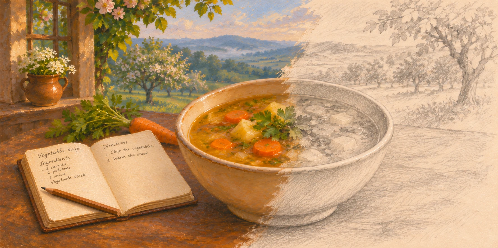

# Recipe template



This file sets out how every recipe in this repository is written. Follow it whenever you create or edit a recipe, whether you are a person or an LLM. Use it together with the [Terminology glossary](Terminology_glossary.md), which pins the exact words the recipes use.

**To write a new recipe:**

1. Read the [Terminology glossary](Terminology_glossary.md).
2. Copy [the template](#the-template) into a new file in the `recipes/` folder, named as described in [File names](#file-names).
3. Fill in every `{placeholder}`, following the [rules](#rules) for each section. Wherever the glossary has a term for something, use it exactly. In **Credits**, put yourself as the **Original author**.
4. Delete any optional section you don't need, and the **Start ahead** column if nothing has to be started ahead.
5. If the recipe uses another recipe as an ingredient, add it to that recipe's **Used in** section. That counts as editing that recipe, so add yourself to its **Editors** too, unless you're already credited there.
6. Add every new term the recipe uses to the glossary, as described in [Terminology](#terminology).
7. Add the recipe to the [recipe table](README.md#recipes) in the README, at its place A to Z by title, with the dish's emoji (the one before its title) and its **Course** and **Type** tags.
8. Check your work against the [checklist](#checklist).

**To edit a recipe:**

1. Read the [Terminology glossary](Terminology_glossary.md).
2. Make your changes, following the [rules](#rules) for each section you change.
3. Add yourself to the recipe's **Editors**, unless you're already credited there, as described in [Credits](#credits).
4. Add every new term your changes use to the glossary, as described in [Terminology](#terminology).
5. If you change the recipe's title or emoji, or its **Course** or **Type** tags, update its row in the [recipe table](README.md#recipes) in the README.
6. Check your work against the [checklist](#checklist).

For complete examples, see [Thai Yellow Curry Paste](recipes/Thai_yellow_curry_paste.md) and [Thai Yellow Prawn Curry](recipes/Thai_yellow_prawn_curry.md).

## Sections at a glance

Keep the sections in this order.

| Section | Required? | What goes in it |
| --- | --- | --- |
| Title | Yes | The name of the dish |
| Photo | Optional | A photo of the finished dish |
| Description | Yes | What the dish is, in 100 words or fewer |
| Summary box | Yes | How far ahead to start (if needed), prep time, cook time, total time and servings |
| Before you start | Optional | Anything the cook must do or know before Step 1 |
| Equipment | Optional | Kit beyond the basics |
| Ingredients | Yes | Everything you need, in the order you use it |
| Directions | Yes | Step 1, Step 2 and so on, with any tips and photos under their steps |
| Notes and substitutions | Optional | Swaps, shortcuts, variations and buying tips |
| Storage and make-ahead | Optional | Fridge, freezer, make-ahead and reheating |
| Used in | Component recipes only | Recipes that use this one as an ingredient |
| Origin | Yes | The country and (if known) region the dish comes from |
| Tags | Yes | Category tags, grouped into Course, Type, Main ingredient and Diet, and the allergens the recipe contains |
| Credits | Yes | Who added the recipe, and who has edited it since |
| Sources | Yes | Where the recipe's ideas came from |

## The template

```markdown
# {Dish emoji} {Recipe Title}


{What the dish is, what it tastes like and, if it helps, how to serve it. 100 words max.}

| Start ahead | Prep time | Cook time | Total time | Servings |
| --- | --- | --- | --- | --- |
| {The night before} | {15 min} | {30 min} | {45 min} | {4} |

## 📌 Before you start

- {Something the cook must do or know before Step 1.}

## 🔪 Equipment

- {Item} ({alternative, if there is one})

## 🥕 Ingredients

#### {Group name, only if the recipe has more than one part}

- {amount} {unit} {ingredient}, {preparation}
- {amount} {unit} [{Linked Recipe Title}]({Linked_recipe_title}.md)
- {ingredient}, to taste

## 🍳 Directions

#### Step 1: {Short title}.

{What to do, how hot, how long, and how to tell when it's done.}

> **Tip:** {Why something matters, or what can go wrong.}

#### Step 2: {Short title}.

{...}

## 📝 Notes and substitutions

- **{Topic}:** {Swap, shortcut, variation or buying tip.}

## 🫙 Storage and make-ahead

- 🧊 **Fridge:** {How long it keeps}. {How to store it.}
- ❄️ **Freezer:** {How long it keeps}, or up to {time} if vacuum packed. {How to thaw it.}
- 📅 **Make ahead:** {What you can do in advance.}
- ♨️ **Reheat:** {How to reheat it.}

## 🔗 Used in

- [{Recipe Title}]({Recipe_title}.md)

## 🗺️ Origin

- **Country:** {Flag} {Country}
- **Region:** {Region}

{1–2 sentences about where the dish comes from, if there's something useful to say.}

## 🏷️ Tags

- **Course:** {Emoji} {Tag}
- **Type:** {Emoji} {Tag}
- **Main ingredient:** {Emoji} {Tag}
- **Diet:** {Emoji} {Tag}, {Emoji} {Tag}
- **Allergens:** {Emoji} {Tag}, {Emoji} {Tag}. {Which store-bought ingredients to check the labels on, if any.}

## ✍️ Credits

- **Original author:** [{GitHub username}](https://github.com/{GitHub username})
- **Editors:** [{GitHub username}](https://github.com/{GitHub username}), [{GitHub username}](https://github.com/{GitHub username})

## 📚 Sources

- {Website}: [{Page title}]({URL}). {What this recipe took from it.}

---

© {Year added} [John-44](https://github.com/John-44). Licensed under [CC BY-NC-SA 4.0](https://creativecommons.org/licenses/by-nc-sa/4.0/).
```

## Rules

### Writing style

- Write for a home cook who has never made the dish.
- Use plain English and short sentences.
- Write directions as instructions: "Fry the onion", not "The onion should be fried".
- Be specific. Give amounts, times, heat levels and sizes. Avoid vague words like "some", "a little" or "a while".
- Explain an unusual technique in a few words the first time it appears, e.g. "Crack the coconut milk (simmer the thick part from the top of the can until the oil separates out)."
- Use British English spelling and UK ingredient names: coriander, spring onions, aubergine, courgette, red pepper, prawns, chillies, plain flour, double cream.
- Write numbers as digits: "2 minutes", not "two minutes".
- Call each thing by the same name every time, in this recipe and every other. Use the terms in the [Terminology glossary](Terminology_glossary.md), as described in [Terminology](#terminology).
- No life stories, adverts or hype ("the best ever").
- Only use emoji where [the template](#the-template) puts them: before the title, the section headings, the storage labels, the country and each tag. Each of these always has one. Don't add emoji anywhere else, such as to ingredients, equipment, step titles or notes, where only some items would have one.
- You can use a source's wording, such as a doneness cue it already puts well, as long as the source is listed in **Sources**. Keep it to a sentence or two from each source.

### Terminology

The [Terminology glossary](Terminology_glossary.md) pins the exact words the recipes in this repository use: ingredients, equipment, dish names, preparation and cooking terms, headings and labels, shops, brands, food labels, origins, tags and sources. It stops recipes drifting apart, with one asking for "coriander leaves" and the next for "fresh coriander".

**Before you write:** read the glossary, whether you're writing a new recipe or editing one.

**While you write:**

- When the recipe needs something the glossary lists, use its term exactly: the same words, spelling, hyphens, word order and capitals.
- Never call something by a name in its **Don't use** column.
- In the ingredient list, write each ingredient's full term. After that, you can shorten it as far as its **Short name**: "raw king prawns" in the list can be "the prawns" in the directions. **Before you start** and **Equipment** come before the list, so use full terms there too.
- If two ingredients in the same recipe would end up with the same short name, keep more of each term, such as "dried chillies" and "red chilli".
- Only reuse a term when it means exactly the same thing. If you need something different, such as ground ginger rather than ginger, give it a new term. Don't stretch an existing term to fit, or reword it to suit one recipe.

**When you've finished:**

- Add every term the recipe uses that isn't in the glossary yet, including swaps that appear only in **Notes and substitutions**, and anything that appears only in **Before you start** or a tip. Put each one in the right section and family, at the place the glossary's [ordering rules](Terminology_glossary.md#how-the-tables-are-ordered) give it, not at the end of the table. Fill in its columns as described in [How the entries work](Terminology_glossary.md#how-the-entries-work).
- Before you add a term, check it isn't another name for something the glossary already has. If it is, change the recipe to use the existing term.

**When you change a term or delete a recipe:**

- Don't change an existing term just because you prefer another word. If a term really does need to change, change it in the glossary and in every recipe that uses it, at the same time.
- If no recipe uses a term any more, remove it from the glossary. Tags and step titles are the exceptions: the tag list keeps every tag, and a step title can stay for later recipes.

### File names

- All recipes go in the `recipes/` folder, with no subfolders.
- The file name is the recipe title in Sentence_case: a capital first letter, everything else lower case, underscores instead of spaces, and `.md` on the end.
- Leave out apostrophes, accents and other punctuation.

| Title | File name |
| --- | --- |
| Thai Yellow Curry Paste | `Thai_yellow_curry_paste.md` |
| Pad Thai | `Pad_thai.md` |
| Mum's Lasagne | `Mums_lasagne.md` |
| Crème Brûlée | `Creme_brulee.md` |

### Linking to other recipes

- Link with the file name only. All recipes are in the same folder, so no path is needed: `[Thai Yellow Curry Paste](Thai_yellow_curry_paste.md)`.
- The link text is the other recipe's title, exactly as written.
- Link a recipe where it appears in **Before you start** and in the ingredient list. In the directions, just use its name.
- You can also link from **Notes and substitutions**, e.g. "For a chicken version, see [Thai Yellow Chicken Curry](Thai_yellow_chicken_curry.md)."
- Only link to recipes that exist. If the one you need doesn't exist yet, write it first using this template, or list the ingredient without a link.
- If a store-bought version works, add `(or store-bought, see Notes)` to the ingredient line and give details in **Notes and substitutions**.
- If you rename or delete a recipe, update every link to it.

### Title

- Use Title Case and the name a UK cook would recognise.
- Include the main ingredient when the dish comes in several versions: "Thai Yellow Prawn Curry", not "Yellow Curry".
- Use an English name, unless the dish is best known in the UK by its original name (e.g. "Pad Thai"). Mention the original name in the description instead.
- Don't use brackets in the title.
- Put an emoji for the dish before the title, as in `# 🍤 Thai Yellow Prawn Curry`, and use the same one in the recipe's row in the [recipe table](README.md#recipes) in the README. The emoji isn't part of the title, so leave it out of the file name and of links to the recipe.

### Photos

- A photo of the finished dish goes straight under the title. It's optional, but it shows the cook what they're aiming for.
- A step can have a photo too, under the step and above any tip, when a first-timer can't picture what to look for, such as cracked coconut milk. Most steps won't need one.
- Only use photos you took yourself, or have permission to use. Never copy one from a website.
- Put photos in the top-level `images/` folder. Name the finished-dish photo after the recipe's file, and a step photo after the recipe's file plus what it shows: `Thai_yellow_prawn_curry.webp`, `Thai_yellow_prawn_curry_cracked_coconut_milk.webp`.
- Resize each photo to about 1,800 pixels wide, and save it as a WebP of 400 KB or less.
- Describe what the photo shows in its alt text: ``.
- If you rename or delete a recipe, rename or delete its photos too, and update their links.

### Description

- 100 words max. Two to four sentences is usually enough.
- Say what the dish is, what it tastes like, what makes this version good and, if it helps, how to serve it.
- Give the dish's original name if it has one, e.g. "Known in Thailand as *gaeng garee*."
- Anything the cook needs to do or know before they start, such as overnight marinating or another recipe that must be made first, goes in **Before you start**, not here.

### Summary box

- Write times as `10 min`, `1 hr` or `1 hr 30 min`.
- **Start ahead:** how far ahead of Step 1 every cook has to begin anything in **Before you start** that takes time to work, such as refrigerating a can or soaking beans: `The night before` for an overnight wait, `The day before` for a longer one, or a time such as `1 hr`. If nothing has to be started ahead, delete the column.
- **Prep time:** hands-on time preparing ingredients, such as chopping, measuring and pounding.
- **Cook time:** time on the hob or in the oven. Write `None` if there's no cooking.
- **Total time:** from Step 1 to the end of the last step, including any wait under 2 hr, such as soaking, marinating, resting or cooling. Don't count time twice when things overlap, such as chopping while something soaks, but only when a step tells the cook to do them at the same time (see [Directions](#directions)).
- Put a wait of 2 hr or more in the steps after the time instead, starting with `plus` and saying what's happening, so the cook can tell where it falls: `45 min, plus 4 hr marinating` or `30 min, plus overnight setting`. Join two or more waits with "and": `1 hr, plus 2 hr proving and 2 hr cooling`. Write `overnight` when the recipe says to leave something overnight.
- Leave waits that not every cook needs, such as thawing frozen prawns, out of the summary box. They go only in **Before you start**.
- Times are for this recipe only. Don't include the time it takes to make linked recipes: give that in **Before you start** instead.
- **Servings:** the number of people it feeds, e.g. `4`.
- For a component recipe (a paste, sauce, stock, dressing or spice mix), rename the **Servings** column to **Makes** and give the amount, e.g. `About 250 g (enough for 2 curries for 4)`.

### Before you start

- Use it for anything the cook must do or know before Step 1, so nothing catches them out halfway through, such as:
  - Other recipes to make first, with their total time: `Make the [Thai Yellow Curry Paste](Thai_yellow_curry_paste.md) first (35 minutes), or use store-bought paste.`
  - Anything that needs doing hours or a day ahead, such as thawing, soaking or marinating overnight. If every cook has to do it, show how far ahead in **Start ahead** too (see [Summary box](#summary-box)), and start the bullet with when to do it: "The night before, refrigerate the can of full-fat coconut milk…".
  - Buying advice the recipe depends on. Send the cook to the note with the details, as in "(see **Coconut milk**)".
  - Safety advice and protective kit, such as gloves for fresh turmeric.
  - Anything else important that must be known before starting to make the recipe.
- Write one bullet per point, as an instruction, in 1–2 sentences.
- Leave out anything the ingredient list or Step 1 already makes clear. If that leaves nothing, delete the section.

### Equipment

- List every piece of kit the recipe uses that a basic kitchen might not have, wherever the recipe mentions it, e.g. a mortar and pestle, spice grinder, stick blender, wok, probe thermometer, gloves, or a 20 cm square cake tin.
- Give an alternative in brackets if there's a good one: `- Mortar and pestle (or a stick blender)`.
- If it isn't obvious what an item is for, say after a comma: `- Gloves, for the fresh turmeric`.
- Don't list the basics: knives, scissors, chopping boards, pans, bowls, spoons, scales, measuring spoons and jugs.

### Ingredients

Write each ingredient on its own line, in the order you use it, following this pattern. Leave out any part the ingredient doesn't need:

`- {amount} {unit} {size or state} {ingredient}, {preparation} ({short note}), plus extra to taste`

```markdown
- 400 g peeled raw king prawns, deveined
- 2 lemongrass stalks, top half and tough outer layers removed, finely sliced
- 1 can (400 ml) full-fat coconut milk (used in Steps 2, 4 and 5)
- 1 tbsp coconut oil (only if needed, see Step 2)
- 125 g [Thai Yellow Curry Paste](Thai_yellow_curry_paste.md) (or store-bought, see Notes)
- 1 tbsp grated palm sugar (about ¼ of a palm sugar block), plus extra to taste
- 10 g Thai basil leaves (about a handful)
- Salt, to taste
```

- If the [glossary](Terminology_glossary.md#ingredients) lists the ingredient, use its term exactly. If it doesn't, name the ingredient as you'd find it in a UK shop, such as "raw king prawns", "unsalted butter" or "plain flour", and add it to the glossary.
- Put the preparation after a comma: "finely chopped", "peeled and finely chopped".
- The amount is measured before the preparation after the comma: `12 g galangal, peeled and finely chopped` means weigh it, then peel and chop it. If you mean the amount after preparing, put the state before the name: `400 g peeled raw king prawns`, `1 tbsp grated palm sugar`.
- Use brackets for short notes only, such as `(optional)` or a quick swap. Put longer advice in **Notes and substitutions**, or in a [tip](#tips) if it's about technique.
- Use `(optional)` for something the cook can leave out. For a fallback they only need if something goes wrong, use `(only if needed, see Step {number})` instead, so they still have it to hand.
- If you add an ingredient in more than one step, such as half in Step 5 and the rest in Step 7, say which steps: `2 tsp tamarind paste (used in Steps 5 and 7)`. Otherwise a cook who has measured everything out may add it all at once.
- If the **Taste and adjust** step might add more of an ingredient, end its line with `plus extra to taste`, after any note in brackets: `1 tbsp grated palm sugar (about ¼ of a palm sugar block), plus extra to taste`.
- Don't list water you only use for soaking, boiling or thinning, as in "Cover with boiling water and soak until soft". That includes soaking water you keep for a later step, as in "Drain, keeping 3 tbsp of the soaking water". Do list water when it's a measured part of the dish, such as `2 metric cups water` for a soup.
- If the recipe has distinct parts, group the ingredients under level 4 (`####`) subheadings, such as `#### For the marinade` and `#### To serve`.

#### Measurements

| Measure | Use it for | Example |
| --- | --- | --- |
| g, kg | Solid ingredients, and pastes over 4 tbsp: meat, fish, vegetables, herbs and leaves, flour, sugar, rice, noodles, curry paste | `500 g raw king prawns` |
| metric cups | Liquids over 4 tbsp and under 1 L, when the amount fits a metric cup measure | `1 metric cup chicken stock` |
| ml, L | Other liquids over 4 tbsp | `350 ml evaporated milk` |
| tsp, tbsp | Small amounts of anything, up to 4 tbsp: spices, salt, sauces, oil, pastes | `2 tbsp fish sauce` |
| cans | Ingredients sold in cans, when you use the whole can | `1 can (400 g) chopped tomatoes` |
| cartons | Ingredients sold in cartons, when you use the whole carton | `1 small carton (250 ml) coconut cream` |
| Count | Things you naturally count | `4 garlic cloves`, `2 eggs` |
| To taste | Seasoning you adjust at the end | `Salt, to taste` |

- 1 tsp = 5 ml, 1 tbsp = 15 ml and 1 metric cup = 250 ml. Spoon measures are always level, so don't write "level". Never use heaped or rounded spoons, because a heap varies from cook to cook. If a source uses them, count each one as 2 level spoons, so 1 heaped tsp becomes 2 tsp.
- A standard can is 400 g (or 400 ml for liquids such as coconut milk). Always give the size in brackets: `1 can (400 g) chickpeas, drained and rinsed`, `2 cans (400 g each) chopped tomatoes`.
- Cartons come in several sizes, so say whether you need a small or large one, and always give its size in brackets: `1 small carton (250 ml) coconut cream`.
- If you only use part of a can or carton, give the amount in g, ml or metric cups instead: `200 ml full-fat coconut milk`.
- A liquid fits a metric cup measure when it's a whole number of metric cups, or ends in ¼, ⅓, ½, ⅔ or ¾ of one: 125 ml is `½ metric cup`, 250 ml is `1 metric cup` and 375 ml is `1½ metric cups`. Give any other amount in ml, as in `200 ml extra virgin olive oil`. Can and carton sizes stay as printed on the pack, as in `1 small carton (250 ml) coconut cream`.
- Write "metric cup" in full, never just "cup". A US cup is smaller, about 240 ml, so convert a US recipe's cups to ml before you decide whether an amount fits.
- Only use metric cups for liquids. Weigh herbs and leaves in grams, as in `10 g Thai basil leaves`. You can also give a rough guide in brackets, as in `10 g Thai basil leaves (about a handful)`.
- Round to amounts that are easy to measure: `250 g`, not `247 g`. Switch to kg and L from 1,000: `1.2 kg`, `1.5 L`.
- Use ½, ⅓, ⅔, ¼, ¾ and ⅛ with spoons, cans and counts (`1½ tsp`), and all but ⅛ with metric cups. Don't use fractions with g or ml.
- Give a size for counted items when it matters (`1 large onion`), and a rough weight when it matters a lot (`1 large potato (about 300 g)`).
- Put a space between the number and the unit: `500 g`, `2 cm`.

### Directions

Start each step with a level 4 (`####`) heading containing the step number and short title. Leave a blank line before the instructions. A short step can have one paragraph of instructions. For a longer stage, use short paragraphs or an unnumbered list under the same step number:

```markdown
#### Step 1: Prep the prawns.

Peel and devein the prawns, keeping the heads for Step 3.

Toss the prawns in a bowl with the salt and bicarbonate of soda, but leave out the salt if the label on the prawns lists salt, and the bicarbonate of soda if it lists a stabiliser. Refrigerate them until Step 9.

#### Step 2: Crack the coconut milk.

- Without shaking the can, spoon the thick part from the top of the can (about 150 ml) into a wok or a saucepan at least 24 cm across.
- Bring to boil over medium-high heat, then simmer over medium heat, stirring often, until it's thick and the oil separates out, 7–12 minutes.
```

- Each step covers one stage of cooking. Keep it short, but never by moving an action, a time or a doneness cue out of it.
- Group related actions in each paragraph or bullet. Put actions after a substantial wait in a new paragraph or bullet.
- Keep any step photo and tips after the step's final paragraph or bullet.
- Start the step title with a verb and keep it to 2–5 words: "Fry the paste."
- Say how hot (low, medium-low, medium, medium-high or high heat), how long, and how to tell when it's done: "until golden, about 5 minutes". Give the most reliable cue you know, such as "until they turn pink and curl into a loose C" for prawns.
- Where a thermometer is more reliable than looking or touching, such as for meat, frying oil, sugar or bread, give the temperature too: "Heat the oil to 180°C."
- Give a pan's size when it changes the result, such as how fast a sauce reduces or whether food fits in one layer: "a wok or a saucepan at least 24 cm across".
- Put every action in the step where the cook does it, including:
  - Optional actions, saying what they depend on: "If you're using head-on prawns, fry the heads…"
  - Conditional actions: "If the oil hasn't separated out after 12 minutes, stir in the coconut oil."
  - Anything the cook does while something else cooks or soaks, including preparing ingredients: "While it simmers, cook the jasmine rice." or "While the chillies soak, toast the coriander seeds…"
- A short warning stays in its step: "Stop before they blacken." Put why something matters, or what can go wrong, in a [tip](#tips) under the step.
- Write "minutes" and "hours" in full here, and in **Before you start**. Only the summary box uses `min` and `hr`.
- Give oven temperatures in °C with the fan temperature in brackets: `200°C (180°C fan)`.
- Use the same ingredient names as the ingredient list, or shorten them as far as their [glossary](Terminology_glossary.md#ingredients) short names: "the prawns" for raw king prawns. Only repeat an amount when you add an ingredient in more than one step: "Add half the coconut milk (200 ml)."
- If the recipe has separate parts, such as a marinade and a sauce, you can introduce each group of steps with a bold label matching its ingredient group, such as `**For the marinade**`. Reserve `####` headings in the directions for steps. A `#### To serve` ingredient group doesn't need a label. Keep counting steps across groups. Don't restart at Step 1.
- When you add, remove or reorder steps, update every step number the recipe mentions to match: in ingredient labels, **Before you start**, other steps, tips, **Notes and substitutions** and **Storage and make-ahead**.
- A **Taste and adjust** step is optional, even for a savoury dish. If you add one, put it at the last point where the seasoning can still change. That's near the end for a sauce, soup, stew or curry, or before baking for a pie filling. If the dish finishes with something that cooks in a few minutes, such as prawns, put the step just before it goes in, so it doesn't overcook while you taste. Leave it out where there's no such point, such as for bread or a roast, and for a raw paste or spice mix, which you can't judge by tasting.
- In the **Taste and adjust** step, say what the dish should taste like, such as "rich, savoury and slightly sweet, with a hint of sourness", what to add to fix each thing that's off, and how much to add at a time, such as "Adjust it ½ tsp at a time: more fish sauce if it needs salt". If it's eaten with something plain, such as rice, say how that changes the target, as in "It's eaten with plain rice, so it should be strongly seasoned". If the cook might thin or thicken it, give a target for how thick it should be too.
- Finish with how to serve.

#### Tips

A tip is the advice a professional chef, or a cook from where the dish comes from, would give someone making it for the first time. It goes directly under the step it's about, as a quote:

```markdown
#### Step 9: Cook the prawns.

Add the prawns and simmer until they turn pink and curl into a loose C, 2–3 minutes. Take the curry off the heat straight away.

> **Tip:** The prawns keep cooking in the hot sauce. If they curl into a tight O, they've gone too far.
```

- A tip says why something matters, what can go wrong and how to spot it early, or what mistake people often make.
- A tip never asks the cook to do anything the step doesn't. If the advice is an action, or changes the method, put it in the step instead. Never contradict the step.
- Don't repeat the step. Keep each tip to 1–3 sentences.
- Leave out anything most home cooks already know, such as "taste as you go" or "don't let the garlic burn". Most steps won't need a tip, and a simple recipe may have none.
- If a step needs two tips, give each one its own quote, with a blank line between them. If the step has a photo, the photo goes first.
- Advice the cook needs before Step 1, such as wearing gloves for fresh turmeric, goes in **Before you start** instead.
- Take tips from people who know the dish well, such as cooks from where it comes from, advice on Reddit and professional chefs, or from your own experience of making it many times. List any website, video or book a tip came from in **Sources**.

### Notes and substitutions

- Write one bullet per note, starting with a bold topic: `- **Store-bought paste:** Brands vary in heat and saltiness, so start with less and add more to taste.`
- Keep each note to 1–2 sentences.
- Put notes about ingredients first, in the order of the ingredient list. Then variations, such as **Chicken instead**, **More heat** and **Vegetarian**, A to Z. Then notes about equipment, such as **Stick blender**.
- Useful things to include:
  - Swaps for hard-to-find ingredients, and where to buy them (e.g. "Asian supermarkets").
  - A store-bought swap for a linked recipe, with the amount to use.
  - How to make the dish milder or hotter.
  - Other main ingredients that work, with a link if this repository has that recipe.
  - How to make the recipe with different equipment, such as a mortar and pestle instead of a stick blender.
  - Dishes or ingredients with similar names that are easy to confuse.
- If the cook needs a note before they shop or start, such as which coconut milk to buy, point to it from **Before you start** too.
- Advice on how to cook the recipe as written goes in the directions or a [tip](#tips), not here. Instructions that come with a swap stay with it, such as when to add chicken instead of prawns.

### Storage and make-ahead

- Use these labels, each after its emoji, and leave out any that don't apply: 🧊 **Fridge**, ❄️ **Freezer**, 📅 **Make ahead**, ♨️ **Reheat**.
- Follow UK food safety guidance from the [Food Standards Agency](https://www.gov.uk/government/publications/how-to-chill-freeze-and-defrost-food-safely/how-to-chill-freeze-and-defrost-food-safely) and the NHS:
  - Cool leftovers and put them in the fridge within 1–2 hours. Eat them within 2 days.
  - Eat cooked rice within 24 hours, and reheat it only once.
  - Thaw frozen food in the fridge, and eat it within 24 hours of thawing.
  - Reheat food until it's steaming hot all the way through.
- For food that isn't vacuum packed, up to 3 months in the freezer is a safe default.
- If you're not sure how long something keeps, give the shorter time.

#### Vacuum packing

- Assume the cook uses a chamber vacuum packer. If the recipe can be vacuum packed, end the first sentence of its **Freezer** entry with how long it keeps that way: `Up to 3 months in a freezer bag, or up to 1 year if vacuum packed.`
- Never give a vacuum-packed time in the **Fridge** entry. Vacuum packing slows the bacteria that make food look and smell off, but not *Listeria* or non-proteolytic *C. botulinum*, which can both grow in a vacuum-packed bag at fridge temperatures (see the FSA's [vacuum packaging guidance](https://www.gov.uk/government/publications/vacuum-packaging/vacuum-packaging)). Vacuum-packed food can seem fine after it has stopped being safe, so give the same fridge time whether or not it's vacuum packed.
- Take the time from the closest entry in OutOfAir's [Food Expiration Chart](https://outofair.com/blog/food-expiration-chart-shelf-life-of-your-vacuum-sealed-food), such as "Sauces" for a curry paste. Where it has nothing close, use [Turbovac's shelf life table](https://turbovac.nl/shelf-life-table/). List the source in **Sources**, and use the shortest time if more than one entry fits or the entry gives a range.
- Leave vacuum packing out where neither source has anything close, where it doesn't make the food keep any longer, and from a **Freezer** entry that says `Not recommended`.
- Don't include instructions for vacuum packing the food.

### Used in

- Only component recipes have this section: pastes, sauces, stocks, dressings, spice mixes and anything else used as an ingredient in other recipes.
- List every recipe in this repository that uses this one as an ingredient, in alphabetical order.
- When a new recipe uses a component, add the new recipe to the component's **Used in** list at the same time.

### Origin

- Give where the dish itself comes from, not where this version was created.
- **Country:** the country's flag, then its current English name, e.g. `🇹🇭 Thailand`. Take the flag from the glossary's [Countries](Terminology_glossary.md#countries) table.
- **Region:** the region, state, province or city it comes from, e.g. `Southern Thailand`, `Sichuan` or `Naples`. Don't give it a flag, even if it has one, such as England, because most regions don't.
- If the dish comes from the whole country rather than one region, write `Nationwide`.
- If experts disagree, give the most widely accepted answer, add `(disputed)`, and explain why in 1–2 sentences under the list.
- Don't guess. If you can't find a reliable answer regarding the **Country**, write `❓ Unknown`. If you can't find a reliable answer regarding the **Region**, don't write anything: leave the **Region** line out.
- You can add 1–2 sentences under the list about where the dish comes from, such as the community or cuisines behind it. Anything about cooking it belongs in **Notes and substitutions**.

### Tags

- Each tag is a single category: `Pastes`, not `Pastes and sauces`. If two categories apply, use two tags.
- Choose from the [tag list](Terminology_glossary.md#tags) in the Terminology glossary, spelled exactly as shown, and put each tag's emoji from the list before it.
- Every recipe needs at least one **Type** tag and an **Allergens** line. Add **Course**, **Main ingredient** and **Diet** tags where they apply.
- Give each group its own line: the group's name in bold, then its tags, separated by commas, as in `- **Diet:** 🥥 Dairy-free, 🌽 Gluten-free`.
- Keep the groups in the tag list's order: **Course**, **Type**, **Main ingredient**, **Diet**, then **Allergens**. Leave out any group with no tags, apart from **Allergens**.
- On each line, put the tags in the order the tag list gives them.
- Don't tag the country or cuisine. That's what **Origin** is for.
- Only use a **Diet** tag if the whole recipe qualifies, including linked recipes. For example, fish sauce and shrimp paste aren't vegetarian, and ordinary soy sauce contains wheat, so it isn't gluten-free.
- **Allergens** lists which of the UK's 14 main allergens the recipe contains as written, including linked recipes, so the cook can check it against a guest's allergies. If it contains none, write `✅ None`.
- If a store-bought ingredient often contains one of the 14, depending on the brand, end the **Allergens** line by telling the cook to check its label: `- **Allergens:** 🦀 Crustaceans, 🐟 Fish. Check the labels on the chicken stock and curry powder, which can contain celery, mustard or gluten.`
- If no tag fits, add a new one, with its own emoji, to the glossary's tag list (following the same rules), then use it. **Allergens** is the exception: it's the FSA's fixed list, so never add to it.

### Credits

- Name each person by their GitHub username, exactly as GitHub shows it, linked to their GitHub profile: `[John-44](https://github.com/John-44)`. Don't use the name on their profile, which can be blank and can change.
- **Original author:** the person who first committed the recipe to this repository.
- **Editors:** everyone else who has had a pull request that changes the recipe merged into `main`. List each person once, in the order of their first merged change, separated by commas.
- Never list the original author as an editor, even if they edit the recipe later.
- If no one else has edited the recipe, leave out the **Editors** line.
- Any merged change to the recipe's file counts, however small, including a change made to every recipe at once, such as renaming a term. Credit the person who opened the pull request, not the co-authors of its commits.
- Update the credits in the same pull request as your change:
  - When you add a recipe, add yourself as **Original author**.
  - When you change a recipe you're not credited on yet, add yourself to the end of its **Editors** line. If your pull request isn't merged, your credit goes with it.
  - If you're an LLM, credit the person whose GitHub account will open the pull request. If you're not sure who that is, ask.

### Sources

- List every website, video or book that shaped the recipe, one per line:
  `- {Website}: [{Page title}]({URL}). {What this recipe took from it.}`
- For example: `- Serious Eats: [Prik Gaeng Garee (Thai Yellow Curry Paste)](https://www.seriouseats.com/prik-gaeng-garee-yellow-curry-paste-5190967). Toasting the spices before grinding.`
- Use the page's real title and full URL. Only include links you have opened and checked. Never make one up.
- For a book, give the title, author and page number instead of a link.
- If the recipe is entirely your own, write `- None. This is an original recipe.`

## Checklist

- [ ] The file is in `recipes/` and named as described in [File names](#file-names).
- [ ] The description is 100 words or fewer.
- [ ] **Start ahead** says how far ahead of Step 1 every cook has to begin anything in **Before you start** that takes time to work. If there's nothing, the column has been deleted.
- [ ] **Total time** runs from Step 1 to the end of the last step, with any wait of 2 hr or more in the steps after `plus`, and only counts overlaps that a step tells the cook to do.
- [ ] **Before you start** has everything the cook must do or know before Step 1, including other recipes to make first and how long they take.
- [ ] Every ingredient is used in the directions, and every ingredient in the directions is in the list, apart from water for soaking, boiling or thinning.
- [ ] Measurements follow the [measurement rules](#measurements), and every can and carton has its size.
- [ ] Every ingredient added in more than one step says which steps, and everything **Taste and adjust** might add more of says "plus extra to taste".
- [ ] Every action, including optional ones and anything done while something else cooks or soaks, is in the step where the cook does it, with the most reliable doneness cue.
- [ ] Every step title uses a level 4 (`####`) heading, with a blank line before the instructions.
- [ ] Longer steps use short paragraphs or bullets where helpful, with actions after a substantial wait in a separate paragraph or bullet.
- [ ] Any **Taste and adjust** step is at the last point the seasoning can still change, or just before anything that cooks in a few minutes goes in, and says what the dish should taste like and how to fix each thing that's off, with how much to add at a time.
- [ ] Every tip sits under the step it's about, and none repeats the step, contradicts it or adds an action to it.
- [ ] Every step number the recipe mentions, in any section, points to the right step.
- [ ] **Equipment** lists every piece of kit beyond the basics that the recipe uses, including protective kit.
- [ ] Every photo is your own or one you have permission to use, is in `images/`, and has alt text.
- [ ] Every link points to a recipe that exists, and the link text matches its title.
- [ ] The **Freezer** entry follows the [vacuum packing rules](#vacuum-packing), and the **Fridge** entry gives no vacuum-packed time.
- [ ] Each linked component recipe lists this recipe under **Used in**.
- [ ] **Origin** has a country, and a region if you found a reliable answer.
- [ ] Tags come from the [tag list](Terminology_glossary.md#tags), or you've added new ones to it, and each group is on its own line, in the tag list's order.
- [ ] The [recipe table](README.md#recipes) in the README has a row for the recipe, with the same emoji, title and **Course** and **Type** tags.
- [ ] The title, section headings, storage labels, country and tags have their emoji, and nothing else has one.
- [ ] The **Allergens** line lists every one of the 14 allergens the recipe contains, including in linked recipes.
- [ ] You're credited in **Credits** on every recipe you've added or changed.
- [ ] Everything the [Terminology glossary](Terminology_glossary.md) lists is called by its exact term or short name, and nothing is called by a name from a **Don't use** column.
- [ ] Every new term the recipe uses has been added to the glossary.
- [ ] Every source URL is real and you have checked it.
- [ ] Optional sections with nothing in them have been deleted.
- [ ] No `{placeholders}` are left.

---

© 2026 [John-44](https://github.com/John-44). Licensed under [CC BY-NC-SA 4.0](https://creativecommons.org/licenses/by-nc-sa/4.0/).
