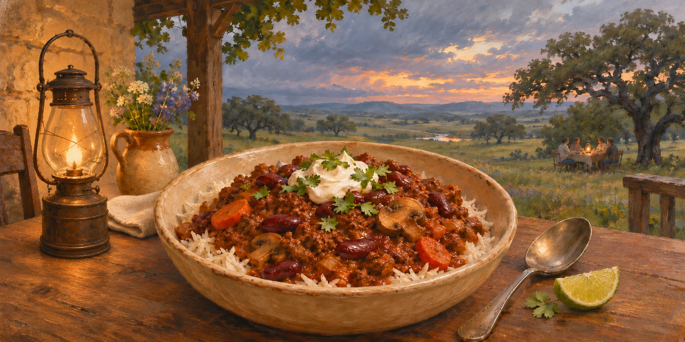

# 🌶️ Chilli con Carne

A rich, smoky chilli con carne of seared beef mince and red kidney beans, slow cooked in red wine and finely chopped tomatoes with a spice blend of sweet smoked paprika, ground cumin and dried herbs. Shiitake mushrooms, demi-glace, Worcestershire sauce and a little dark chocolate give it extra depth, dried bird's eye chillies give it a gentle heat, and lime juice and coriander leaves and stalks freshen it at the end. It makes a big batch, and like most stews it tastes even better the next day. Serve with rice and soured cream.

| Prep time | Cook time | Total time | Servings |
| --- | --- | --- | --- |
| 35 min | 3 hr 25 min | 4 hr | 8 |

## 🔪 Equipment

- Microwave
- 28 cm stainless steel pot, holding at least 6 L, with a lid (not non-stick)
- Colander
- Measuring cup

## 🥕 Ingredients

#### For the spice blend

- 1 tbsp ground cumin
- 2 tsp smoked sea salt flakes
- 1 tsp ground black pepper
- 1 tsp MSG
- 2 heaped tbsp sweet smoked paprika
- 2 tsp ground ginger
- 2 heaped tsp ground coriander
- 2 heaped tsp dried oregano
- 2 heaped tsp dried thyme
- 1 tsp dried marjoram
- 1 tsp medium curry powder

#### For the chilli

- 3 dried bird's eye chillies
- 4 medium onions, finely chopped
- 2 large carrots, peeled and finely sliced
- 12 garlic cloves, peeled and finely chopped (about 1 bulb)
- 300 g shiitake mushrooms, stalks removed, cut into bite-size pieces and washed
- 2 tbsp ghee
- 1 kg lean beef mince (10% fat is ideal, or use 5% fat)
- 50 g unsalted butter
- 1 tsp fine sea salt
- 4 tbsp olive oil (used in Steps 4 and 5)
- 100 g tomato purée (about 6 tbsp)
- 2 metric cups red wine (used in Steps 4 and 6)
- 3 cans (400 g each) finely chopped tomatoes
- 4 bay leaves
- 3 tbsp Worcestershire sauce
- 2 tbsp thick demi-glace (or concentrated beef stock, see Notes)
- 20 g dark chocolate (80% or 90% cocoa solids)
- 2 cinnamon sticks
- 1 tbsp apple cider vinegar
- 2 cans (400 g each) red kidney beans, drained and rinsed
- 100 g coriander leaves and stalks, washed and roughly chopped
- 2 limes

#### To serve

- 600 g basmati rice
- 300 ml soured cream

## 🍳 Directions

#### Step 1: Prep the ingredients.

- Take the mince out of the fridge, so it isn't fridge-cold when it goes in the pot.
- Mix the dry spices to create the spice blend, and set aside.
- Split the bird's eye chillies open lengthways with scissors and scrape out the seeds. Place them on a plate and microwave on high power 15 seconds at a time until they're pliable and toasted-smelling, about 30 seconds total. Leave them to cool until crisp, about 1 minute, then finely chop them.
- Finely chop the onions and place in a bowl. Peel and finely slice the carrots, and add them to the bowl. Peel and finely chop the garlic.
- Remove the stalks from the mushrooms, then halve the caps, or quarter any wider than 4 cm. Wash them in cold water and pat them dry with kitchen roll.

#### Step 2: Sear the mince.

Put ½ tbsp of the ghee in the pot, and heat it over high heat until it starts to smoke.

Sear the mince in 4 batches of about 250 g, by pressing each batch down gently into a flat layer in the pot. Leave it undisturbed for 2–4 minutes so a deep, caramelised crust can form. Then flip it so the other side browns, about 2 minutes, then break the meat apart and place it in a colander on top of a plate so it can drain. Before each of the next 3 batches, add another ½ tbsp of the ghee and heat it until it starts to smoke.

If the fat smokes heavily or the fond (the browned bits stuck to the bottom of the pan) starts to blacken, turn the heat down to medium-high.

#### Step 3: Fry the mushrooms.

After all the mince has been removed from the pot, turn the heat down to medium and wait 1 minute, so the butter doesn't burn in the hot pot. Add half the butter, then add the mushrooms and the salt. Cover with the lid and let them cook for 8–10 minutes, stirring occasionally, until the mushrooms have released all their liquid.

Then remove the lid, add the rest of the butter and cook, stirring occasionally, until the mushrooms are deep golden brown and tender, about 15 minutes. While the mushrooms brown, start Step 4, and keep stirring the mushrooms occasionally.

Remove the mushrooms from the pot and place them in a bowl on the side, ready for Step 7.

#### Step 4: Fry the tomato purée.

In a mini frying pan, heat 2 tbsp of the olive oil over medium-low heat. Add the tomato purée, and fry, stirring all the time, for 2–5 minutes. You will know when the tomato purée is ready because it will have gone from bright red to a darker brick or rust colour, smells sweet rather than sharp, and starts to catch on the bottom of the pan. Be careful not to burn it!

Take the mini frying pan off the heat, pour in ½ metric cup of the wine, and stir, scraping the bottom of the pan, until nothing is stuck to it. Set it aside for Step 6.

#### Step 5: Fry the aromatics and carrots.

Add the rest of the olive oil (2 tbsp) to the pot over medium heat, then add the onions and carrots. Fry, stirring often, for 8–10 minutes, or until the onions are soft, squidgy and slightly translucent.

Drop the heat to medium-low, then add the garlic and spice blend and stir for 3 minutes, taking care not to burn the garlic or spices.

#### Step 6: Add the stew ingredients.

Turn the heat up to high and pour in the rest of the wine (1½ metric cups) to deglaze the pot. Boil it for 2 minutes, scraping the bottom to lift the fond.

Add the tomatoes, bay leaves, Worcestershire sauce, demi-glace (or concentrated beef stock), dark chocolate, cinnamon sticks, apple cider vinegar and bird's eye chillies. Then add the tomato purée and wine from Step 4, and the mince you seared in Step 2, with any juices from the plate. Stir well.

#### Step 7: Slow cook the chilli.

Bring to a simmer, then turn the heat down to low. Cook for 1½ hours at this low temperature with the lid on, stirring occasionally so it doesn't catch on the bottom of the pot.

Then add the kidney beans and the mushrooms, remove the lid and cook for another 30 minutes to thicken, stirring occasionally, until a spoon dragged across the bottom of the pot leaves a clear trail. While it simmers, cook the rice, and wash and roughly chop the coriander leaves and stalks.

#### Step 8: Finish the chilli.

Turn off the heat, lift out the bay leaves and cinnamon sticks, then add the roughly chopped coriander leaves and stalks and the freshly squeezed lime juice, and stir well.

#### Step 9: Serve the chilli.

Divide the rice between 8 bowls, spoon the chilli over the top, and add a spoonful of soured cream to each.

## 📝 Notes and substitutions

- **Red wine:** Use an inexpensive, medium-bodied red. Avoid oaky, sweet or very tannic (mouth-drying) wines, because reducing the wine concentrates those flavours.
- **Demi-glace:** A thick, rich sauce base made by reducing beef or veal stock. If you can't find it, use the same amount of concentrated beef stock, such as [M&S Concentrated Beef Stock](https://www.marksandspencer.com/food/concentrated-beef-stock/p/fdp20002097).

## 🫙 Storage and make-ahead

- 🧊 **Fridge:** Up to 2 days. Divide it between airtight containers so it cools quickly, and refrigerate it within 1–2 hours. Store leftover rice separately, eat it within 24 hours, and reheat it only once.
- ❄️ **Freezer:** Up to 3 months in a freezer bag, or up to 1 year if vacuum packed. Thaw it in the fridge overnight, and eat it within 24 hours.
- 📅 **Make ahead:** Make the chilli up to the end of Step 7, leaving the rice and the coriander leaves and stalks until the day you serve it. Lift out the bay leaves and cinnamon sticks, then leave it to cool and refrigerate it for up to 2 days. On the day, reheat it until steaming hot all the way through, then carry on from Step 8.
- ♨️ **Reheat:** Reheat it in a saucepan over medium-low heat, stirring often, until steaming hot all the way through.

## 🗺️ Origin

- **Country:** 🇺🇸 United States (disputed)
- **Region:** Texas

It grew out of Mexican stews of beef in a red chilli sauce, and became popular in Texas, which made it the state's official dish in 1977. Wikipedia gives both Mexico and the United States as its place of origin.

## 🏷️ Tags

- **Course:** 🍽️ Mains
- **Type:** 🍲 Stews
- **Main ingredient:** 🐄 Beef
- **Allergens:** 🌾 Cereals containing gluten, 🐟 Fish, 🥛 Milk, 🍷 Sulphites. Check the labels on the demi-glace (or concentrated beef stock), the curry powder and the dark chocolate, which can contain celery, mustard or soya.

## ✍️ Credits

- **Original author:** [John-44](https://github.com/John-44)

## 📚 Sources

- America's Test Kitchen: [The Best Wine for Cooking (Is Not What You Think)](https://www.americastestkitchen.com/articles/1271-the-best-wine-for-cooking-is-not-what-you-think). Choosing an inexpensive, medium-bodied red, and avoiding oaky, sweet or very tannic wines, whose flavours cooking concentrates.
- BBC Food: [Easy chilli con carne](https://www.bbc.co.uk/food/recipes/chilliconcarne_67875). Using 1 kg of lean beef mince with a cinnamon stick and Worcestershire sauce, boiling the red wine before the tomatoes go in, adding the kidney beans near the end with plenty of roughly chopped coriander leaves, finishing with lime, serving it with rice and soured cream, and that it tastes better a day or two after it's made.
- Don't Go Bacon My Heart: [The BEST Chilli Con Carne in the World](https://www.dontgobaconmyheart.co.uk/chilli-con-carne/). Using 3 tbsp of Worcestershire sauce with 1 kg of mince, simmering the red wine before the tomatoes go in, and simmering the chilli with the lid on over low heat for 1½ hours, then uncovered until it thickens.
- Good Food: [Chilli con carne recipe](https://www.bbcgoodfood.com/recipes/chilli-con-carne-recipe). How the onions should look when they're ready (in its words), the dried marjoram, stirring as it simmers so it doesn't catch on the bottom of the pan, and using only a little dark chocolate, so it adds depth without being tasted.
- Hairy Bikers: [Chilli con carne](https://www.hairybikers.com/recipes/view/chilli-con-carne). Using lean beef mince with 10% fat or less.
- Love the Kitchen: [Chilli con carne with Shiitake mushrooms](https://lovethekitchen.co.uk/chilli-con-carne-with-shiitake-mushrooms/). Adding shiitake mushrooms, carrots and cinnamon sticks; the spice blend of sweet smoked paprika, ground ginger, ground coriander, ground cumin, dried oregano, dried thyme and smoked sea salt flakes, measured in heaped spoons and mixed before you start; the finely chopped tomatoes, lime juice, and coriander leaves and stalks.
- M&S: [Concentrated Beef Stock](https://www.marksandspencer.com/food/concentrated-beef-stock/p/fdp20002097). The swap for demi-glace, and its ingredients for the **Allergens** line.
- Nicky's Kitchen Sanctuary: [Chilli Con Carne](https://www.kitchensanctuary.com/chilli-con-carne/). Using 80% or 90% dark chocolate and ground ginger, simmering the red wine before the rest goes in, simmering for an hour before adding the kidney beans, and stirring in the coriander leaves just before serving.
- OutOfAir: [Food Expiration Chart: The Shelf Life of Your Vacuum Sealed Food](https://outofair.com/blog/food-expiration-chart-shelf-life-of-your-vacuum-sealed-food). How long the chilli keeps in the freezer when vacuum packed, from its entry for stews.
- RecipeTin Eats: [Chilli Con Carne](https://www.recipetineats.com/chilli-con-carne/). Slow cooking it for 1½–2 hours with the lid on, over low heat.
- Serious Eats: [Sautéed Mushrooms](https://www.seriouseats.com/sauteed-mushrooms-recipe-7972096). The mushroom technique, its timings and some of its wording: removing the shiitake stalks and halving or quartering the caps, cutting them before washing, cooking them with salt and half the butter, with the lid on, until they release their liquid, then uncovered with the rest of the butter until deep golden brown and tender.
- Serious Eats: [The Best Chili Ever](https://www.seriouseats.com/the-best-chili-recipe). Microwaving the dried chillies until pliable and toasted-smelling (in its words), adding chocolate and cider vinegar, heating the fat until it smokes and turning the heat down if it smokes heavily or the meat starts to burn, frying the onions for longer, and lifting out the bay leaves at the end.
- Waitrose: [Lea & Perrins Worcestershire Sauce](https://www.waitrose.com/ecom/products/lea-perrins-worcestershire-sauce/034619-17411-17412). Its ingredients, including barley malt vinegar and anchovies, for the **Allergens** line.
- Wikipedia: [Chili con carne](https://en.wikipedia.org/wiki/Chili_con_carne). Its place of origin, its Mexican roots and Texas making it the state's official dish in 1977, for the **Origin**.

---

© 2026 [John-44](https://github.com/John-44). Licensed under [CC BY-NC-SA 4.0](https://creativecommons.org/licenses/by-nc-sa/4.0/).
