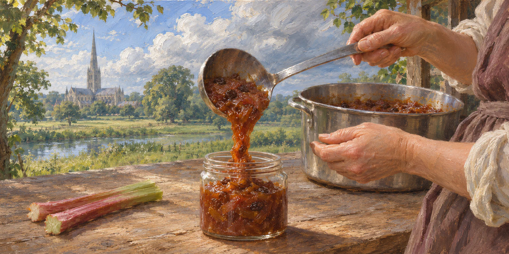

# 🫙 Granny Lea's Rhubarb Chutney

A thick, sweet and sharp chutney of rhubarb and raisins, simmered in malt vinegar with sugar and plenty of mild curry powder, which gives it a warm, spicy flavour without much heat. This version follows Granny Lea's handwritten family recipe. As the chutney matures in the jars, the sharpness of the vinegar mellows. Serve it in cheese sandwiches, with jacket potatoes, or with cold meats.

| Prep time | Cook time | Total time | Makes |
| --- | --- | --- | --- |
| 25 min | 2 hr 15 min | 3 hr, plus 1 month maturing | About 2 L |

## 📌 Before you start

- Make it at least 1 month before you want to eat it, so the malt vinegar has time to mellow (see Step 7).
- Buy malt vinegar, not non-brewed condiment (see **Malt vinegar**).
- Before Step 3, open the kitchen windows and shut the doors to the rest of the house, as boiling malt vinegar gives off strong fumes.

## 🔪 Equipment

- Stainless steel preserving pan, holding at least 9 L (or a wide stainless steel pot of the same size)
- Colander, for blanching the rhubarb
- Measuring cup
- Mason jars with vinegar-proof lids, holding about 2.5 L in all (such as 10 holding 250 ml each)
- Tongs, for lifting the jars out of the boiling water
- Ladle
- Jam funnel

## 🥕 Ingredients

- 2 kg rhubarb, washed and cut into 1 cm chunks
- 1 kg granulated sugar
- 500 g raisins
- 60 g mild curry powder
- 2½ metric cups malt vinegar
- 1 tbsp fine sea salt

## 🍳 Directions

#### Step 1: Prep the rhubarb.

Cut off any leaves and throw them away, as they're poisonous. Wash the rhubarb in cold water and pat it dry with kitchen roll. Cut off the ends, then cut the rhubarb into 1 cm chunks. There's no need to peel it.

#### Step 2: Blanch the rhubarb (optional).

If rhubarb is from earlier in the season, carry on from Step 3. This step is only for end of season rhubarb, around July or August.

Put the rhubarb in the preserving pan, and pour in enough cold water to cover it. Bring up to almost a boil over high heat, about 15 minutes, then drain it in the colander straight away, throwing away the water.

> **Tip:** Rhubarb gets more acidic as the season goes on. Heating in water draws out some of the acid, which can be discarded with the water.

#### Step 3: Dissolve the sugar.

Put the rhubarb, sugar, raisins, curry powder, vinegar and salt in the preserving pan. Heat it over medium-low heat, stirring often, until the sugar has dissolved and you can't see any grains of it on the back of the spoon, about 15 minutes.

> **Tip:** Rhubarb and vinegar are both acidic, so they react with aluminium and copper, which can give the chutney a metallic taste.

#### Step 4: Simmer the chutney.

Turn the heat up to medium-high and bring to boil, then turn the heat down to medium-low, so it simmers. Simmer, uncovered, stirring occasionally, until it's thick and jammy (there's no liquid on the surface, and when you drag a spoon across the bottom of the pan, it leaves a clear trail that doesn't fill with liquid), 1½–2 hours.

After 45 minutes, start Step 5, and keep stirring occasionally, more often as it thickens, so it doesn't catch on the bottom of the pan.

#### Step 5: Sterilise the jars.

Wash the mason jars and their lids in hot, soapy water, and rinse them. Stand the jars upright on a folded cloth in a large pot, and cover them by 3 cm with water from the hot tap. Bring to boil over high heat, then boil for 10 minutes to sterilise them. Turn off the heat, and leave the jars in the hot water until the chutney is ready.

#### Step 6: Jar the chutney.

When the chutney is ready, take the preserving pan off the heat, and leave it for 5 minutes, so it stops bubbling.

Lift the jars out of the water with tongs and tip out the water. Fill them one at a time: ladle in the hot chutney through the jam funnel, to 1 cm from the top, run a clean knife around the inside to let out any pockets of air, wipe the rim with a damp cloth, and screw the lid on tightly straight away. Leave to cool.

> **Tip:** Vinegar reacts with bare metal, so the lids need to be vinegar-proof, with a plastic coating on the inside.

#### Step 7: Serve the chutney.

Once the jars are cool, label them with the date, and store them in a cool, dark cupboard for at least 1 month before you open one. It's even better after 2–3 months. Serve it in cheese sandwiches, with jacket potatoes, or with cold meats.

> **Tip:** You can eat it straight away, but it tastes sharp until the vinegar mellows.

## 📝 Notes and substitutions

- **Rhubarb:** Frozen rhubarb works too. Thaw it in the fridge overnight, and drain off the liquid before you start, or the chutney takes longer to thicken.
- **Malt vinegar:** An ordinary, inexpensive malt vinegar is all you need. Check that the label says malt vinegar, though, not non-brewed condiment, a cheaper vinegar substitute for seasoning chips.
- **Bigger batch:** Granny Lea often made 2 or 3 times as much, as it keeps so well. You'll need a pan that holds 2 or 3 times as much too, and to stir it more often, as a bigger batch takes longer to thicken and is more likely to catch on the bottom of the pan.
- **More heat:** Granny Lea chose the curry powder's strength to taste. Use the same weight of medium curry powder for a little more heat, or hot curry powder for a much hotter chutney.
- **Other versions:** Many other rhubarb chutneys add onions, and some add ginger or dates too. Granny Lea's recipe doesn't use them, and this one leaves them out on purpose.

## 🫙 Storage and make-ahead

- 🗄️ **Cupboard:** Up to 1 year unopened. Keep the jars somewhere cool and dark.
- 🧊 **Fridge:** Up to 2 months once opened. Keep the lid screwed on tightly.

## 🗺️ Origin

- **Country:** 🇬🇧 United Kingdom

Chutney comes from the Indian subcontinent, and once British travellers brought it home in the 17th century, British cooks made their own with local fruit and vegetables. Rhubarb was first recorded as a food in 18th- to 19th-century England (once sugar became affordable), and was a good acidic replacement for the unavailable green mango used in chutneys previously exported to England. The Lichfield Mercury printed a recipe for rhubarb chutney in 1914.

## 🏷️ Tags

- **Course:** 🥄 Condiments
- **Type:** 🫙 Chutneys
- **Main ingredient:** 🍎 Fruit
- **Diet:** 🥥 Dairy-free, 🫑 Vegetarian, 🌱 Vegan
- **Allergens:** 🌾 Cereals containing gluten. Check the label on the curry powder, which can contain mustard.

## ✍️ Credits

- **Original author:** [John-44](https://github.com/John-44)

## 📚 Sources

- Family recipe: Granny Lea's handwritten recipe for rhubarb chutney. Its ingredients, their proportions and its method, which this recipe follows, filling in only what it leaves out, and its hints: using an inexpensive vinegar, choosing the curry powder's strength to taste, airing the room and shutting the doors while the vinegar boils, blanching end-of-season rhubarb to take away some of its acidity, and making 2 or 3 times as much, as it keeps so well.
- Farmersgirl Kitchen: [Rhubarb Chutney](https://www.farmersgirlkitchen.co.uk/rhubarb-chutney/). Washing the rhubarb, dissolving the sugar over gentle heat before it simmers, checking the label says malt vinegar and not non-brewed condiment, that curry powder comes in mild, medium and hot strengths, that the chutney tastes sharp straight away and is better after 1 month and better still after 3, that a bigger batch is more likely to stick to the pan, keeping unopened jars for up to a year, serving it in cheese sandwiches or with cold meats, and its onions, for **Other versions**.
- Foods of England: [Rhubarb Chutney](https://foodsofengland.info/rhubarbchutney.html). The Lichfield Mercury's recipe for rhubarb chutney from 1914, for the **Origin**.
- From The Larder: [Essential Chutney and Jam Making Equipment Guide](https://fromthelarder.co.uk/jam-making-equipment-guide/). A 9 L stainless steel preserving pan rather than aluminium or copper, which react with vinegar, a jam funnel, and jars of about 250 ml.
- Larder Love: [How To Make Chutney And Relish](https://larderlove.com/tips-tricks/how-to-make-chutney-and-relish/). Washing and patting dry the fruit, simmering it for 1–2 hours, the test for when it's ready (no liquid on the surface, and a spoon leaving a clear line across the bottom of the pan), leaving it off the heat for 5 minutes before filling the jars, running a knife around the inside of the jars to let out any air, and labelling them and storing them somewhere cool and dark.
- National Center for Home Food Preservation: [Sterilization of Empty Jars](https://nchfp.uga.edu/how/can/general-information/sterilization-of-empty-jars/). Covering the jars by 3 cm with water from the hot tap, and boiling them for 10 minutes to sterilise them.
- RHS: [Rhubarb](https://www.rhs.org.uk/fruit/rhubarb/grow-your-own). That the leaves are poisonous, and that the last rhubarb of the season is usually picked around July or August.
- Ricardo: [Sterilization 101](https://www.ricardocuisine.com/en/articles/food-chemistry/279-sterilization-101). Filling the jars to 1 cm from the top, and wiping the rims.
- River Cottage: [Glutney](https://rivercottage.net/recipes/glutney/). Heating it gently until the sugar has dissolved before bringing it to boil, simmering it uncovered and stirring it so it doesn't burn on the bottom of the pan, plastic-coated lids to stop the vinegar reacting with the metal, and that it's best after 2 months.
- The Delectable Garden: [Grandma's Rhubarb Chutney Recipe – Sweet and tangy, with spices](https://thedelectablegarden.co.uk/2025/09/28/grandmas-rhubarb-chutney-recipe-sweet-and-tangy-with-spices/). Not peeling the rhubarb, filling the hot jars straight away and sealing them with vinegar-proof lids, thawing and draining frozen rhubarb, that unopened jars keep for a year somewhere cool and dark, eating an opened jar within a couple of months, kept in the fridge, and its onions and dates, for **Other versions**.
- Vialii Gardens: [Rhubarb Chutney Recipe](https://vialiigardens.co.uk/yummy-rhubarb-chutney/). Its copy of a Good Food recipe for rhubarb and date chutney. Simmering it uncovered until it's thick and jammy (in its words), keeping it for at least a month before eating it, and its onions, ginger and dates, for **Other versions**.
- Waitrose: [How to sterilise jars](https://www.waitrose.com/ecom/content/inspiration/at-home-with-us/how-to-sterilise-jars). Washing the jars and their lids in hot, soapy water first.
- Waitrose: [Sarson's Malt Vinegar](https://www.waitrose.com/ecom/products/sarsons-malt-vinegar/544638-745049-745050). Its ingredients, barley malt vinegar and barley malt extract, for the **Allergens** line.
- Wikipedia: [Chutney](https://en.wikipedia.org/wiki/Chutney). That chutney comes from the Indian subcontinent, was brought to Britain in the 17th century and was made there with local fruit and vegetables, for the **Origin**.
- Wikipedia: [Rhubarb](https://en.wikipedia.org/wiki/Rhubarb). That rhubarb was first recorded as a food in 18th- to 19th-century England, once sugar became affordable, for the **Origin**.

---

© 2026 [John-44](https://github.com/John-44). Licensed under [CC BY-NC-SA 4.0](https://creativecommons.org/licenses/by-nc-sa/4.0/).
