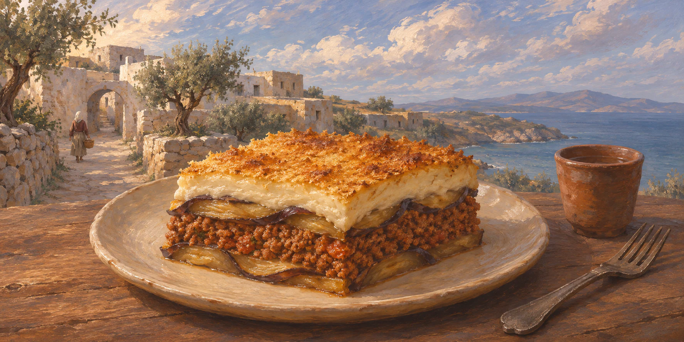

# 🍆 Greek Home-Cooked Moussaka

A rustic Greek recipe, making moussaka the way it would traditionally be made in the home. Layers of fried aubergines and a beef mince sauce, simmered with white wine, fresh tomatoes and parsley leaves, under a thick, egg-enriched béchamel with a golden crust of kefalotyri, breadcrumbs and butter. This version follows a handwritten Greek family recipe. Known in Greece as *mousakás*. Serve it warm rather than hot, once the béchamel has set.

| Prep time | Cook time | Total time | Servings |
| --- | --- | --- | --- |
| 35 min | 2 hr | 3 hr 10 min | 8 |

## 📌 Before you start

- Have the ingredients ready for the [Greek Béchamel Sauce](Greek_bechamel_sauce.md), which you'll make in Step 5 (30 minutes).
- Buy 120 g kefalotyri from a Greek deli or online (60 g for this recipe and 60 g for the béchamel), or use a swap (see **Kefalotyri**).

## 🔪 Equipment

- Box grater, for the tomatoes
- Measuring cup
- Baking dish, about 20 × 30 cm and at least 7 cm deep
- Baking tray
- Probe thermometer, for reheating

## 🥕 Ingredients

- 750 g ripe vine tomatoes
- 2 tbsp finely chopped onion
- 10 g flat-leaf parsley leaves, finely chopped
- 60 g kefalotyri, finely grated (or Pecorino Romano) (used in Steps 6 and 7)
- 750 g beef mince (15% fat)
- 130 g unsalted butter (used in Steps 2, 4 and 7)
- ½ metric cup white wine
- 1½ tsp fine sea salt (used in Steps 3 and 4)
- ¾ tsp freshly ground black pepper (used in Steps 3 and 4)
- 1.25 kg aubergines (about 4)
- 1½ metric cups olive oil, for frying
- 1.2 L [Greek Béchamel Sauce](Greek_bechamel_sauce.md) (1 batch)
- 120 g dried breadcrumbs (used in Steps 6 and 7)

## 🍳 Directions

#### Step 1: Prep the ingredients.

- Halve the tomatoes. Grate the cut side of each half on the coarse holes of the box grater into a bowl, until only the skin is left in your hand. Throw away the skins.
- Finely chop enough onion to fill 2 tbsp, and finely chop the parsley leaves.
- Finely grate the kefalotyri.

#### Step 2: Fry the mince.

Put the mince, 40 g of the butter and the onion in a large saucepan, at least 24 cm across, over medium-high heat. Fry, stirring often and breaking up the lumps with a spoon, until the mince is no longer pink and starts to brown, 8–10 minutes.

Pour in the wine and let it bubble until the raw wine smell has gone, 1–2 minutes.

#### Step 3: Simmer the meat sauce.

Add the tomatoes, parsley leaves, 1 tsp of the salt and ½ tsp of the pepper, and stir. Bring to a simmer, then turn the heat down to medium-low, so it keeps simmering.

Simmer, uncovered, stirring occasionally, until the juices have been absorbed (when you drag a spoon across the bottom of the pan, no liquid runs into the gap), 30–40 minutes. While it simmers, start Step 4, and keep stirring the sauce occasionally, more often as it thickens, so it doesn't catch on the bottom of the pan. When it's ready, take it off the heat.

> **Tip:** The sauce should be much thicker than a pasta sauce. If it's runny, it soaks into the aubergines and runs out when you cut the moussaka.

#### Step 4: Fry the aubergines.

Wash the aubergines, pat them dry with kitchen roll, and cut off the stalks. Slice them lengthways about 7 mm thick.

Melt 40 g of the butter in a large frying pan over low heat, then pour it into a heatproof jug with the oil and stir.

Heat 4 tbsp of the oil and butter in the frying pan over medium heat. Fry the aubergines in batches, in a single layer, until soft and lightly golden on both sides, about 3 minutes per side. Before each new batch, stir the oil and butter and add 2–3 tbsp more to the pan. If bits of butter start to blacken in the pan, wipe it out with kitchen roll before the next batch.

Lift the aubergines onto kitchen roll to drain, then lay them on a large plate, sprinkling each layer with some of the rest of the salt (½ tsp) and pepper (¼ tsp).

#### Step 5: Make the béchamel.

Preheat the oven to 180°C (160°C fan). Make the [Greek Béchamel Sauce](Greek_bechamel_sauce.md).

#### Step 6: Layer the moussaka.

Arrange half the aubergines in neat rows in the baking dish, overlapping them slightly so they cover the bottom.

Stir half the breadcrumbs (60 g) and half the kefalotyri (30 g) into the meat sauce, then spread it evenly over the aubergines. Arrange the rest of the aubergines on top in rows, then pour over the béchamel and spread it to the edges with the back of a spoon.

#### Step 7: Bake the moussaka.

Melt the rest of the butter (50 g) in a small saucepan over low heat. Sprinkle the rest of the kefalotyri (30 g) evenly over the béchamel, then the rest of the breadcrumbs (60 g), and drizzle the melted butter over the top.

Put the baking dish on a baking tray. Once the oven is at temperature, bake until the top is golden brown, 30–40 minutes.

#### Step 8: Serve the moussaka.

Leave it to cool for 45 minutes, so the béchamel and meat sauce set. Then cut it into 8 slices, and serve it warm.

> **Tip:** Straight from the oven, the layers are too soft to cut cleanly, and the béchamel runs. As the moussaka cools, the béchamel sets firm. Many Greek cooks serve it warm rather than hot.

## 📝 Notes and substitutions

- **Vine tomatoes:** Use the ripest you can find. Out of season, use 2 cans (400 g each) finely chopped tomatoes instead, and skip grating them in Step 1.
- **Kefalotyri:** A hard, salty Greek cheese made from sheep's or goat's milk, sold in Greek delis and online. If you can't find it, use the same weight of Pecorino Romano or Parmesan.
- **Elevated version:** For a version with seared mince, garlic, cinnamon and allspice in the meat sauce, and salted aubergines, see [Elevated Greek Moussaka](Elevated_greek_moussaka.md).
- **Lamb instead:** Use the same weight of lamb mince, or half lamb mince and half beef mince. Lamb mince is fattier, so in Step 2, spoon off all but about 2 tbsp of the fat in the pan before you pour in the wine.

## 🫙 Storage and make-ahead

- 🧊 **Fridge:** Up to 2 days. Cover the baking dish with cling film or foil, or divide the moussaka between airtight containers, and refrigerate it within 1–2 hours.
- ❄️ **Freezer:** Up to 3 months in airtight containers, or up to 1 year if vacuum packed. Thaw it in the fridge overnight, and eat it within 24 hours. The crust goes soft once it's been frozen.
- 📅 **Make ahead:** Bake it up to 2 days ahead, then leave it to cool, cover it and refrigerate it within 1–2 hours. Or make the meat sauce up to 2 days ahead: grate the tomatoes, chop the onion and parsley leaves, follow Steps 2 and 3, then leave it to cool and refrigerate it within 1–2 hours. On the day, fry the aubergines (Step 4), reheat the sauce over medium heat, stirring often, until steaming hot all the way through, and carry on from Step 5.
- ♨️ **Reheat:** Cover it with foil and reheat it in the oven at 180°C (160°C fan) until steaming hot all the way through, about 1 hour for the whole dish. A probe thermometer pushed into the centre should read at least 75°C. Without one, a knife pushed into the centre should come out hot.

## 🗺️ Origin

- **Country:** 🇬🇷 Greece

Its name came into Greek from Arabic, through Ottoman Turkish. The Greek version, layered and topped with béchamel, was created by the French-trained Greek chef Nikolaos Tselementes in the 1920s.

## 🏷️ Tags

- **Course:** 🍽️ Mains
- **Type:** 🥘 Bakes
- **Main ingredient:** 🐄 Beef, 🥦 Vegetables
- **Allergens:** 🌾 Cereals containing gluten, 🥚 Eggs, 🥛 Milk, 🍷 Sulphites

## ✍️ Credits

- **Original author:** [John-44](https://github.com/John-44)

## 📚 Sources

- Argiro Barbarigou: [MEASURING: Your helper for converting ingredients and ratios](https://www.argiro.gr/en/mathe-apo-tin-argiro/measuring-your-helper-for-converting-ingredients-and-ratios/). Its 250 ml cup, used for the handwritten recipe's teacups, and how much a cup of grated cheese weighs, to convert the wine and kefalotyri.
- Argiro Barbarigou: [Moussaka](https://www.argiro.gr/en/recipe/moussaka/). Canned chopped tomatoes, for the swap in **Vine tomatoes**.
- Argiro Barbarigou: [Secrets for an authentic moussaka recipe](https://www.argiro.gr/en/ta-mistika-tis-argiros/secrets-for-an-authentic-moussaka-recipe/). Frying the aubergines until lightly golden, and leaving the moussaka to stand for at least 45 minutes and serving it warm, not hot.
- Family recipe: a handwritten Greek recipe for aubergine moussaka. Its ingredients, amounts and method, which this recipe follows, filling in only what it leaves out.
- Food Standards Agency: [Cooking your food](https://www.gov.uk/government/publications/cooking-your-food/cooking-your-food). Checking that the centre of the moussaka reaches at least 75°C when reheating it.
- King Arthur Baking: [Ingredient Weight Chart](https://www.kingarthurbaking.com/learn/ingredient-weight-chart). How much a cup of dried breadcrumbs weighs.
- My Greek Dish: [Traditional Moussaka recipe with eggplants (aubergines) and potatoes](https://www.mygreekdish.com/recipe/mousakas/). The size of the baking dish, draining the fried aubergines on kitchen roll, a meat sauce thick enough not to soak into the aubergines, letting the moussaka cool before cutting it so the béchamel doesn't run, making it ahead and reheating it, and lamb mince, or a mix of lamb and beef mince, as a swap.
- National Center for Home Food Preservation: [Foods That Do Not Freeze Well](https://nchfp.uga.edu/how/freeze/freeze-general-information/foods-that-do-not-freeze-well/). That crumb toppings go soft when frozen.
- OutOfAir: [Food Expiration Chart: The Shelf Life of Your Vacuum Sealed Food](https://outofair.com/blog/food-expiration-chart-shelf-life-of-your-vacuum-sealed-food). How long the moussaka keeps in the freezer when vacuum packed, from its entry for stews.
- RecipeTin Eats: [Moussaka (Greek Beef and Eggplant Lasagna)](https://www.recipetineats.com/moussaka-greek-eggplant-beef-bake/). Slicing the aubergines about 7 mm thick, cooking the wine until the raw wine smell has gone, a meat sauce thicker than a pasta sauce so it doesn't run when you cut the moussaka, simmering it over medium-low heat, baking it at 180°C for 30–40 minutes until golden brown, reheating it until a knife in the centre comes out hot, and lamb mince as a swap.
- Wikipedia: [Kefalotyri](https://en.wikipedia.org/wiki/Kefalotyri). What kefalotyri is made from, and Pecorino Romano or Parmesan as swaps.
- Wikipedia: [Moussaka](https://en.wikipedia.org/wiki/Moussaka). Its Greek name, where its name comes from and Nikolaos Tselementes' Greek version, for the description and **Origin**.

---

© 2026 [John-44](https://github.com/John-44). Licensed under [CC BY-NC-SA 4.0](https://creativecommons.org/licenses/by-nc-sa/4.0/).
