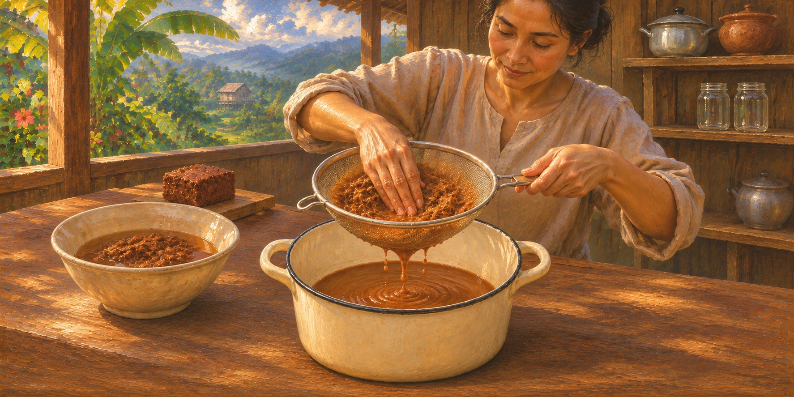

# 🫙 Tamarind Paste

A sour, fruity paste made by soaking a block of tamarind pulp in boiling water, squeezing the flesh off its fibres and straining it. Thai cooks use it to add sourness to curries, stir-fries and salads. It has more flavour than store-bought tamarind paste, which is often weak and varies from tub to tub.

| Prep time | Cook time | Total time | Makes |
| --- | --- | --- | --- |
| 25 min | 25 min | 1 hr 10 min | About 400 ml |

## 📌 Before you start

- Buy a block of tamarind pulp, not whole tamarind pods (see **Tamarind pulp**).

## 🔪 Equipment

- Measuring cup
- Fine-mesh sieve
- 2 mason jars, holding 250 ml each
- Tongs, for lifting the jars out of the boiling water

## 🥕 Ingredients

- 200 g tamarind pulp
- 2 metric cups boiling water

## 🍳 Directions

#### Step 1: Rip the tamarind into chunks.

Rip the tamarind into the smallest chunks you can with your fingers, and put them in a heatproof bowl.

#### Step 2: Soak the tamarind.

Measure the boiling water in a measuring cup and pour it over the tamarind to cover it. Soak until the water is cool enough to touch, at least 20 minutes.

> **Tip:** The longer the tamarind soaks, the easier it is to squeeze the flesh off the fibres.

#### Step 3: Squeeze out the flesh.

Squeeze the tamarind in the water with your fingers, so the flesh comes away from the fibres. Keep going until you have a thick liquid, like a smoothie, and the fibres have no flesh left on them.

If it's thicker than a smoothie, add water 2 tbsp at a time, just until it's like a smoothie.

> **Tip:** Some blocks are pulpier than others and need more water. A mixture that's too thick clogs the fine-mesh sieve in Step 4.

#### Step 4: Strain the paste.

Strain the tamarind through the fine-mesh sieve into a pot that isn't aluminium or copper. Use your hand to rub and push the flesh against the sieve to force it through, and scrape the paste off the underside of the sieve into the pot occasionally. Throw away the fibres left in the sieve.

> **Tip:** Tamarind is acidic, so it reacts with aluminium and copper, which can give the paste a metallic taste.

#### Step 5: Use or store.

Use the paste straight away, or store it:

- Wash the mason jars and their lids in hot, soapy water, and rinse them. Stand the jars upright on a folded cloth in another pot, and cover them by 3 cm with water from the hot tap. Bring to boil over high heat, then boil for 10 minutes to sterilise them.
- As soon as the water boils, bring the paste to boil over medium-high heat, stirring all the time so it doesn't spit. Boil it for 5 minutes, still stirring all the time.
- Lift the jars out of the water with tongs and tip out the water. Pour in the boiling paste, and screw the lids on tightly straight away. Leave to cool, then refrigerate within 1–2 hours.

> **Tip:** As the jars cool, the lids are sucked in and seal, as with jam. The paste isn't properly canned, though, so it still needs the fridge.

## 📝 Notes and substitutions

- **Tamarind pulp:** Look for brown blocks of seedless tamarind pulp from Thailand in Asian supermarkets or online. Whole tamarind pods are the sweet kind, for eating rather than cooking.

## 🫙 Storage and make-ahead

- 🧊 **Fridge:** Up to 1 month in the jars.
- ❄️ **Freezer:** Up to 3 months, or up to 1 year if vacuum packed. Freeze it in an ice cube tray and then a freezer bag, so you can take out a little at a time. Add the cubes to a dish straight from frozen.

## 🔗 Used in

- [Thai Yellow Prawn Curry](Thai_yellow_prawn_curry.md)

## 🗺️ Origin

- **Country:** 🇹🇭 Thailand

Tamarind trees are native to tropical Africa, and tamarind is used across Southeast Asia, India and Mexico. This is the Thai kind, made from sour Thai tamarind.

## 🏷️ Tags

- **Type:** 🌿 Pastes
- **Diet:** 🥥 Dairy-free, 🌽 Gluten-free, 🫑 Vegetarian, 🌱 Vegan
- **Allergens:** ✅ None

## ✍️ Credits

- **Original author:** [John-44](https://github.com/John-44)

## 📚 Sources

- Hot Thai Kitchen: [How to Make Tamarind Paste for Thai Cooking](https://hot-thai-kitchen.com/making-tamarind-paste/). The method, the ratio of pulp to water, a longer soak making the flesh easier to squeeze off, the smoothie-like consistency and adding water if it's too thick, boiling the paste for 5 minutes while stirring all the time, filling small jars while hot and keeping them in the fridge, freezing it in an ice cube tray, buying a block from Thailand rather than whole pods, and that homemade has more flavour than store-bought.
- National Center for Home Food Preservation: [Sterilization of Empty Jars](https://nchfp.uga.edu/how/can/general-information/sterilization-of-empty-jars/). Covering the jars by 3 cm with water from the hot tap, and boiling them for 10 minutes to sterilise them.
- OutOfAir: [Food Expiration Chart: The Shelf Life of Your Vacuum Sealed Food](https://outofair.com/blog/food-expiration-chart-shelf-life-of-your-vacuum-sealed-food). How long the paste keeps in the freezer when vacuum packed, from its entry for sauces.
- Sous Chef: [A Guide To Tamarind Paste And Tamarind Water](https://www.souschef.co.uk/blogs/the-bureau-of-taste/what-is-tamarind-water). Scraping the paste off the underside of the sieve, and where tamarind comes from and is used, for the **Origin**.
- Swasthi's Recipes: [Tamarind Paste Recipe](https://www.indianhealthyrecipes.com/tamarind-paste-recipe-make-tamarind-paste/). Using a pot that isn't aluminium or copper, and how long the paste keeps in the fridge.
- Waitrose: [How to sterilise jars](https://www.waitrose.com/ecom/content/inspiration/at-home-with-us/how-to-sterilise-jars). Washing the jars and their lids in hot, soapy water first.

---

© 2026 [John-44](https://github.com/John-44). Licensed under [CC BY-NC-SA 4.0](https://creativecommons.org/licenses/by-nc-sa/4.0/).
